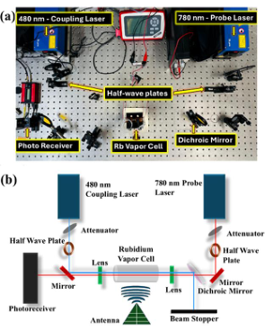
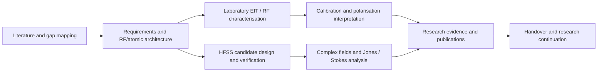

<div align="center">

# RYDBERG RF SENSING
### Atomic receivers · Microwave polarimetry · Information-aware metasurfaces

**Research portfolio / source evidence / reproducible analysis / technical handover**

[**Explore the Research**](docs/START_HERE.md) · [**Engineering Handover**](docs/handover/HANDOVER.md) · [**Evidence Catalogue**](docs/results/EVIDENCE_INDEX.md) · [**Browse the Website**](site/index.html) · [**Interactive Explorer**](site/explorer.html)



*Experimental apparatus image sourced from the editable Rydberg manuscript (Figure 1).*

</div>

---

## Complete project history and technical dossiers

The original source-backed article and V44 numerical evidence are only part of the programme. The expanded archive also reconstructs the prior atomic-receiver experiments, systematic design progression, simulation campaigns, original communication and research software. Start with:

| Dossier | What is preserved / explained |
|---|---|
| [Complete chronology](docs/history/DETAILED_RESEARCH_CHRONOLOGY.md) | March–October research phases, experimental-to-simulation progression, scientific decisions and source anchors |
| [Atomic receiver and laboratory](docs/laboratory/OPTICAL_AND_ATOMIC_RECEIVER.md) · [linear measurements](docs/laboratory/POLARISATION_MEASUREMENTS.md) | 780/480 nm Rb-EIT platform, RF references and Stokes equator distinction |
| [RF design lineage](docs/design/POLARISER_AND_METASURFACE_DESIGN_LINEAGE.md) | Rod grids, analytical PCB polarisers, chiral CP selectors, SAP18B, TetraVia–Omega, finite folded and six-state surfaces |
| [HFSS campaign history](docs/simulations/HFSS_CAMPAIGN_LINEAGE.md) · [verification criteria](docs/simulations/VERIFICATION_AND_INFORMATION_MATRIX.md) | Multi-branch V1–V44 development, complex-field evidence, mesh, conditioning and finite aperture |
| [Atomic modelling and Workbench](docs/software/ATOMIC_MODELLING_AND_WORKBENCH.md) | ARC, Rydiqule, MATLAB, CST, automated HFSS and desktop scientific software |
| [Literature synthesis](docs/literature/THEMATIC_LITERATURE_AND_RESEARCH_GAP.md) · [Stokes derivation](docs/methods/STOKES_MATHEMATICS_AND_DERIVATION_NOTES.md) | Thematic background, research gaps and mathematical conventions |
| [Equipment and engagement](docs/operations/EQUIPMENT_PROCUREMENT_FABRICATION_ENGAGEMENT_HISTORY.md) | Components, PCB processes, quotation-versus-purchase evidence, academic and external engagement |
| [Publication history](docs/publications/PUBLICATION_AND_PRESENTATION_HISTORY.md) | Interim thesis, posters, ICTON conference, APL/IEEE manuscript evolution |
| [Historical asset catalogues](docs/catalog/README.md) | **1,280 additional named Library records discovered**; indexed for retrieval, not misrepresented as GitHub-imported files |
| [Source completeness](docs/handover/RESEARCH_COMPLETENESS_AND_IMPORTS.md) · [next steps](docs/handover/TECHNICAL_HANDOVER_NEXT_STEPS.md) | Import gates, primary evidence gaps, instructions for a successor |
| [Evidence status](docs/traceability/RECORD_STATUS_POLICY.md) · [research stream matrix](docs/traceability/RESEARCH_STREAM_STATUS.csv) | Explicit measured vs simulated vs proposed vs fabricated/purchased/published controls |

**Archive count clarity:** the original release contained 290 actual files. The discovery catalogue lists 1,280 *additional historical source records*, many overlapping/versioned. Their filenames are not automatically original GitHub assets; consult the source-completeness register before claiming a complete byte-for-byte historical mirror.

## Interactive research, technical work packages and archive search

**[Open the scientific explorer](site/explorer.html)** — a responsive, dependency-free research website with a rotatable Poincaré sphere, ideal-polarisation controls, actual HFSS-derived six-state response calculations, model CSV export, interactive research milestones, **search across the tracked research source inventory** and a separate searchable index of **1,280 historical Library-discovery records**. The scientific calculations are offline demonstrations, never represented as physical atomic measurements or new solver runs.

**[Master research work-package register](docs/handover/MASTER_WORK_PACKAGE_REGISTER.md)** — 55 detailed atomic, RF, hardware, HFSS, software, publication and research administration tasks with source anchors and status boundaries. This is the most complete cross-disciplinary work index in the archive.

[Native HFSS and field-reconstruction playbook](docs/methods/HFSS_NATIVE_RESULT_REPRODUCTION.md) · [Experimental calibration and recovery protocol](docs/methods/CALIBRATION_AND_RECOVERY_PROTOCOL.md) · [GitHub research operations](docs/governance/GITHUB_RESEARCH_OPERATIONS.md) · [Website setup and publishing rules](site/README.md).

> **Website publication:** the Pages workflow is deliberately manual and packages only the reviewed `site/` folder, never the private archive's raw paper, lab, supplier or solver directories. Publishing remains subject to institutional and asset release approval.

## Recovered original research source library

The [historical source library](history/README.md) now preserves the actual text of prior **X-BSR electromagnetic design studies, the APL Photonics research plan, MATLAB polarisation/plotting scripts, atomic transition screening, CST setup, scientific software verification, the early editable thesis, HFSS historical verdicts and later manuscript reviews**. This content is organised separately from the V44 main-paper HFSS evidence. It is source material, not a claim of verified fabrication or independent experiment.

An additional [byte-level intake register](history/binary-imports/README.md) identifies 13 original binary HFSS, Rydberg Workbench and manuscript archives with exact SHA-256. **These binary archives are not yet uploaded to GitHub.** Follow the [completeness ledger](docs/handover/RESEARCH_COMPLETENESS_AND_IMPORTS.md) for untransferred raw data and the historical 1,280-name Library discovery index.

## Two distinct research products: a general textbook and this evidence archive

**[Rydberg Systems Engineering — 36-chapter general physics textbook](book/README.md)** covers first principles, state selection, optical spectroscopy, EIT, laser construction, RF hardware, cold atom arrays, Rydberg blockade, cavity QED, molecules, precision sensing and computational methods. The book is independent of this individual project's experimental history; its [honest editorial quality gates](book/EDITORIAL_STANDARD.md) explain what remains before publication.

**[Where to find the latest verified work — project evidence portal](docs/research/CURRENT_PROJECT_EVIDENCE_PORTAL.md)** is the single best starting point for experimental and HFSS conclusions, source files, historic designs, candidate status and current technical limitations. **[Australian research, Defence and collaboration watch](automation/README.md)** monitors verified official sources and produces review-only opportunities. The optional [AI co-author](automation/AI_EDITORIAL_POLICY.md) can draft proposals or educational code on branches, never silently rewrite evidence or merge itself.

## Rydberg Systems Engineering — interactive scientific textbook

**[Open the Rydberg Academy](site/academy.html)** · **[Research diagnostic assistant](site/diagnostics.html)** · **[Live physics and code laboratory](site/lab.html)** · **[Complete GitHub book](book/README.md)** · **[Design from zero](book/field-guides/COMPLETE_EXPERIMENT_DESIGN.md)** · **[Universal fault atlas](book/field-guides/UNIVERSAL_DIAGNOSTIC_ATLAS.md)** · **[Latest accepted results and historical limitations](book/CURRENT_STATE.md)** · **[Annotated research bibliography](book/REFERENCES.md)**

The separate research-handbook section contains **36 original chapters across quantum, atomic, optical, RF and emerging Rydberg research** with answers, **1,000 reproducibly generated fully solved numeric questions**, ARC and RydIQule primers, 16 platform-independent lab tutorials, original editable physics diagrams and a browser-based safe JavaScript calculation workbench. Its optional print workflow creates a 1,000+ page **worked-problem PDF**, not a 1,000-page prose monograph. Teaching calculations are not new measurements or HFSS simulations.

**Research maintenance:** `scripts/research_assistant.py` audits current source, browser/book consistency and project evidence; a weekly [bibliographic metadata watch](.github/workflows/weekly-research-watch.yml) raises review candidates without inventing article conclusions. Learn from books and compare methods against the current V44 *periodic* HFSS evidence while keeping the failing historical finite-panel transfer distinctly labelled.

**Public repository caution:** The repository is currently public. Only authorised research documents and approved figures should be published; do not bulk-commit private laboratory records, purchase information or proprietary manuscripts.

## The research in one minute

This archive documents a microwave sensing programme combining **rubidium-87 Rydberg electromagnetically induced transparency (EIT)**, RF polarisation conditioning and **HFSS-designed, switch-programmable metasurfaces**. The objective is to understand how multiple known analyser states can convert polarisation-dependent responses into a well-conditioned Stokes measurement basis compatible with an atomic receiver.

Work spans literature synthesis, optical/RF system design, laboratory characterisation, numerical modelling, electromagnetic design, polarimetric inference, simulation validation, visual communication and research dissemination.

> **Evidence key:** Experimental measurements and electromagnetic-simulation results are separate. HFSS-derived results are not described as rubidium-cell full-Stokes measurements. Procurement proposals are not treated as purchase confirmations.

## Research highlights

| Research stream | Documented outcome | View evidence |
|:---|:---|:---|
| Rydberg-EIT experimental receiver | Rubidium optical readout, RF-front-end evaluation, magnetic calibration and exploratory experimental work | [Experimental report](reports/2026-06-magnetically-biased-rydberg-receiver.pdf) |
| Polarisation conditioning | Laboratory linear-polarisation contrasts, RF front-end comparisons and Poincaré-equator interpretation | [Experimental evidence](docs/results/EXPERIMENTS.md) |
| HFSS metasurface engineering | Two-face, switch-programmable design and 6 × 4 Stokes instrument using complex simulated fields | [Design and methodology](docs/engineering/METASURFACE.md) |
| Simulation optimisation | 36 geometry candidates; simulated accepted sampled interval of 250 MHz; at 1.925 GHz: rank 4, row-normalised κ₂ = 9.53, independent mesh disagreement 0.551% | [Results](docs/results/KEY_FINDINGS.md) |
| Measurement design | Fixed-time dwell-allocation criterion improved by 40.8% under the article's stated statistical model | [Analysis sources](papers/manuscript-source/data/) |
| Research communication | Research poster, editable technical manuscript, interim research report, publication record and handover documents | [Papers and talks](docs/research/PUBLICATIONS.md) |

## Navigate by purpose

| I want to... | Start here |
|:---|:---|
| Understand the scientific gap and intellectual contribution | [Research overview](docs/research/RESEARCH_NARRATIVE.md) · [Literature map](docs/research/LITERATURE_MAP.md) · [Chronology](docs/research/RESEARCH_CHRONOLOGY.md) |
| Rebuild the experimental setup | [Hardware inventory](docs/engineering/HARDWARE_AND_BOM.md) · [Experimental SOP](docs/methods/EXPERIMENTAL_SOP.md) · [Atomic modelling](docs/methods/ATOMIC_MODELLING.md) |
| Trace the HFSS evidence and reproduce paper figures | [HFSS SOP](docs/methods/HFSS_SOP.md) · [Figure provenance](docs/results/FIGURE_PROVENANCE.md) |
| Inspect source code, measurements and datasets | [Code index](docs/methods/CODE_AND_DATA.md) · [Evidence catalogue](docs/results/EVIDENCE_INDEX.md) |
| Find procurement, fabrication or collaborators | [Procurement](docs/operations/PROCUREMENT.md) · [Fabrication](docs/operations/MANUFACTURING.md) · [Engagement](docs/operations/ENGAGEMENT.md) |
| Take over the research project | [Research handover](docs/handover/HANDOVER.md) · [Successor onboarding](docs/handover/SUCCESSOR_ONBOARDING.md) |
| Inspect what meets the supervisor assessment rubric | [Assessment evidence matrix](docs/traceability/RUBRIC_MAPPING.md) · [Claims ledger](docs/traceability/CLAIMS.md) |

## Project process



## Repository structure

```text
.
├── README.md                       Research overview and navigation
├── docs/                           Narrative, decisions, methods and handover
├── papers/manuscript-source/       Fully editable LaTeX article and figure source
├── papers/current-manuscript-draft.pdf
├── reports/                        Earlier experimental research report
├── presentations/                  Posters and presentation material
├── literature/                     Retained structured-review source
├── designs/                        Portable receiver and hardware proposals
├── evidence/hfss/                   HFSS-derived numerical data, logs and native-return ZIPs
├── research-code/                   Rydberg/ARC scientific source code
├── site/                            Portable, responsive research microsite
├── governance/                      Original assessment rubric
├── scripts/                         Integrity / navigation / evidence checks
└── tests/                           Automated archive and math checks
```

## Reuse and publication

The repository is a **preserved research handover** and a **publication-ready documentation structure**, not a statement that all artefacts have public-release permission. Check institutional IP rules, photograph permissions, proprietary supplier material, third-party licenses and unpublished manuscript status before publishing a public fork. See [release and data policy](docs/operations/RELEASE_POLICY.md). Avoid publishing internal commercial invoices and personal contact details.

**Maintainer:** R. N. Verghese · **Archive assembled:** 31 October 2026 · **Status:** curated from accessible project records; import register tracks additional sources.
