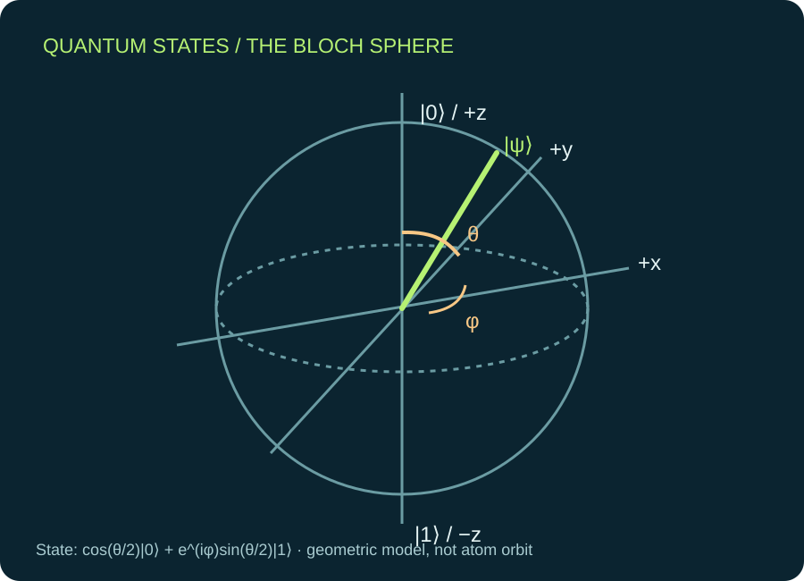
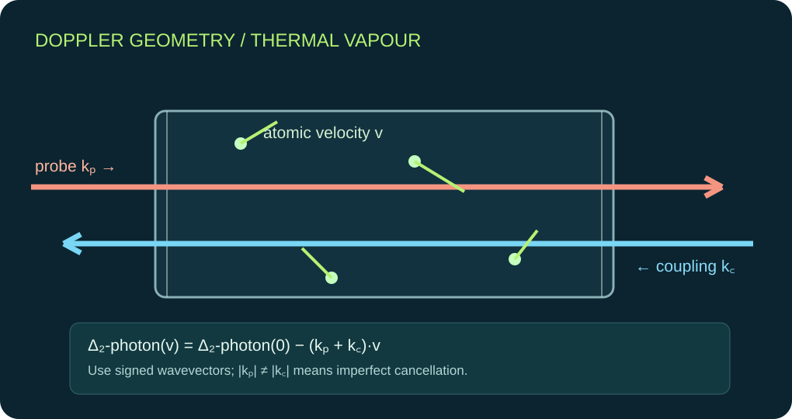
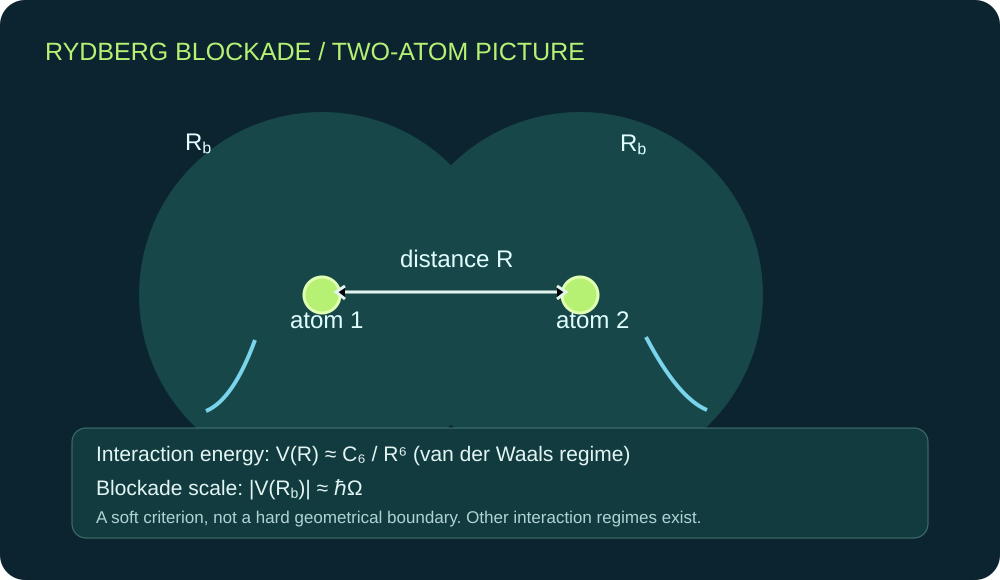

# General textbook figures — editable and scientifically qualified

This book uses **original concept diagrams**, labelled as theoretical visualisations; they are not stock photographs, measured spectra, actual equipment or HFSS solutions.

## Quantum-state geometry

**Source:** [Editable original SVG](../site/assets/book-quantum-bloch.svg). **Physics:** the Bloch sphere maps complex, normalised pure two-level amplitudes modulo global phase to polar/azimuthal coordinates. It is not an electron orbit. Discussed in [Chapter 1](chapters/01-mathematical-language.md).

## Thermal atomic motion and laser beams

**Source:** [Editable original SVG](../site/assets/book-doppler-geometry.svg). **Physics:** signed two-photon Doppler shift, beam wavevector and atomic velocity projection. Unequal wavelengths leave a residual Doppler term. This is not a measured spectral line. [Chapter 16](chapters/16-doppler-and-linewidth.md).

## Two-atom Rydberg blockade

**Source:** [Editable original SVG](../site/assets/book-rydberg-blockade.svg). **Physics:** illustrates the van der Waals (C_6/R^6) regime and an approximate (V(R_b)simhbarOmega) blockade criterion. Other interaction regimes and angular-state mixing exist. [Chapter 25](chapters/25-rydberg-blockade.md).

## Additional teaching diagrams

[Conceptual RF-dressed ladder](../site/assets/academy-ladder.svg), [RF/HFSS source-to-claim flow](../site/assets/academy-hfss-pipeline.svg), and [experimental diagnosis flow](../site/assets/academy-diagnostic-tree.svg) are instructional and may use specific example equipment or architectures. They are not independently observed experimental data.

## Visual production requirements

Every future general-physics chapter should have at least three original scientific diagrams: (i) conceptual mechanism, (ii) equation/variable geometry, (iii) a source-verified plot or quantitative limiting case. Units, signs, legible accessible labels and alt text are mandatory. Native complex source fields must remain attached to actual simulation plots and laboratory data to measurement photographs.

**Project-specific images**, including the actual rubidium optical bench, HFSS figures and experimental polarisers, belong in the separate [project figure atlas](../docs/results/PROJECT_FIGURE_ATLAS.md). The general textbook should not be turned into an illustrated report on one experiment.

[Book home](README.md) · [Editorial standard](EDITORIAL_STANDARD.md).
