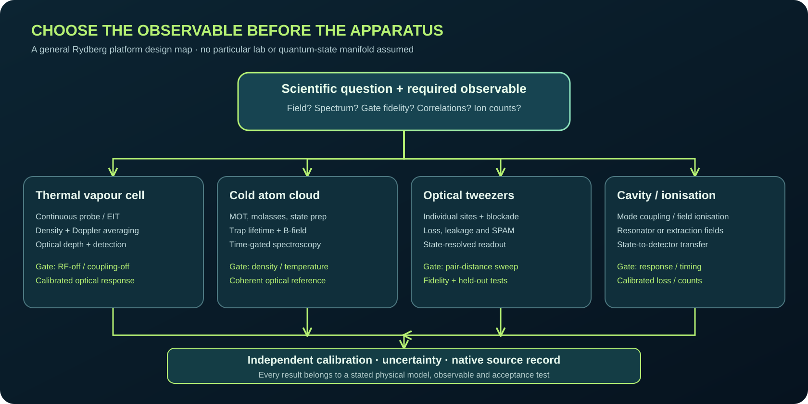

# Designing a Rydberg experiment from zero

*General educational schematic. It is not a laboratory photograph or measured field map.*

**Graduate general reference / systems engineering.** This chapter develops transferable principles rather than an individual laboratory project.

## Competencies

Derive appropriate equations and approximations, identify observables, choose realistic instrumentation, establish numerical and physical controls, and propose a falsifiable research plan.

## 1. Begin with the measurand, not a shopping list

The initial design question is what physical quantity is being inferred: atomic transition energy, microwave field, DC field, quantum gate fidelity, molecular binding energy, many-body correlation or photon statistics. Write a measurand definition with units, required bandwidth, dynamic range, temporal/spatial resolution and uncertainty. Convert that into an experimental observable such as transmitted light, fluorescence, ions, phase shift or survival probability. The observation model determines the apparatus and validation plan. Purchasing a laser and vapour cell first, then searching for a possible signal, is usually an inefficient research strategy.

## 2. Species and platform selection matrix

Compare alkalis (Rb, Cs, K) and divalent atoms (Sr, Yb) with actual target states, laser sources, vacuum or vapour requirements, coherence and transition-dipole strengths. Thermal cells permit compact ensemble spectroscopy but introduce Doppler/transit broadening; cold atom arrays enable site resolution and blockade but require cooling, vacuum and imaging. Beam machines or cavity experiments need other constraints. Make the tradeoff explicit in a weighted decision table rather than declaring one species universally best.

## 3. Build an optical frequency budget

For every ladder or multiphoton path, list initial, intermediate and final states with n,l,j,F,m where appropriate; transition vacuum frequency; laser accessible range; quantum defect; Rabi matrix element; one/two-photon detunings; linewidth; polarization; servo bandwidth and calibration standard. Use ARC for transition proposals and published spectroscopy for verification. A valid optical wavelength is not enough when selection rules, sublevel structure or power constraints make the state inaccessible.

## 4. Build a hardware/readout budget

Define laser power and waist requirements, optical table size, vapour-cell heating or chamber access, RF generator/antenna, detector bandwidth, data acquisition, reference clocks and control electronics. Convert carrier frequency into wavelength, antenna dimensions, reference-plane loss and near/far field conditions. For a field sensor include local field perturbation from windows or nearby metallic structures. An instrument's highest carrier frequency must not be confused with its modulation/detection bandwidth.

## 5. Build a model validation ladder

First verify energy levels and selection rules; then coherent two- and three-level limits; then density matrix with relevant decays; then velocity averaging and spatial propagation; then RF or many-body couplings; then instrument response and the actual estimator. Each stage should have known limiting-case tests and parameter uncertainty. A realistic numerical simulation may be too complex to debug from scratch, so adding all effects at once is counterproductive.

## 6. Commissioning and measurement acceptance

A commissioning plan specifies independent source/calibration standards, off-state controls, time stability, sample sizes, repeatability, safety and failure criteria. For EIT, require coupling-off/RF-off references, optical frequency trace and detector linearity. For atom arrays, require loading, atom loss, motional state and state-detection errors. For microwave polarimetry, require independent calibration states, signed conventions and holdout field reconstruction. Write the acceptance criteria before seeing the successful plot.

## 7. Archive and handover design

Create canonical directories for apparatus, raw data, analysis, solver native files, figures and manuscript claims. Every result needs date, instrument/solver version, physical units, geometry or state revision, source hash and reproducible commands. Record negative and interrupted runs; a later researcher should locate the actual source in seconds from an index. A public research portfolio must not inadvertently publish credentials, personal correspondence or access-controlled Defence material.

## End-of-chapter questions and explanations

### Question 1. Why start with a measurand rather than choosing an atom?

Read the explained answer

The required observable, precision and bandwidth determine the platform and hardware choices.

### Question 2. What makes a nominally accessible Rydberg level unusable?

Read the explained answer

Selection-rule, state lifetime, intermediate-state, laser power, polarization or available RF coupling constraints.

### Question 3. What is the advantage of commissioning in layers?

Read the explained answer

Known analytic limits and independent controls isolate the source of each failure before interacting effects are added.

### Question 4. Why is a wavemeter reading alone insufficient for precision spectroscopy?

Read the explained answer

Its absolute accuracy, calibration and temporal sampling may not resolve the transition detuning required.

### Question 5. Why must acceptance criteria be declared before measurement?

Read the explained answer

Changing thresholds after seeing results invites cherry-picking and hides model failure.

### Question 6. What belongs in a reusable research archive?

Read the explained answer

Raw/native sources, metadata, units, code/environment, plots, claims, failed runs, provenance and access-control policy.

## Applied learning exercise

Write a fully specified, species-independent experiment proposal for a plausible system. Identify microscopic states, interaction Hamiltonian or rate model, detector observable, units, calibration, expected signal scale, failure controls and validation benchmarks. Use at least one independent source to challenge the expected model. An illustrative calculation is never a substitute for a completed experimental measurement.

## References and next steps

See [the master bibliography](../REFERENCES.md), Gallagher's *Rydberg Atoms*, Foot's *Atomic Physics*, and relevant NIST/open research reviews. State which source supplies each parameter before it is used in a real experiment.

---

## Detailed independent reference, extended case study and problem set

*A general graduate field guide — vapour cells, cold ensembles, neutral-atom arrays, RF sensing, spectroscopy and many-body physics. Original explanatory text. Not a protocol authorising unsupervised hazardous laboratory work.*

## 1. The first design decision is the scientific observable

A Rydberg experiment is not defined by purchasing a pair of lasers. It begins with a hypothesis expressed as an observable with known units and a required uncertainty. Examples include a transition frequency, fluorescence count distribution, time-resolved survival probability, atom-number correlation, transmitted optical intensity, dressed-state splitting, ion-arrival histogram or spatially resolved electric field. Each observable implies a different apparatus, state-preparation method, detector and forward model. A single optical vapour cell can be a good field sensor and a poor platform for site-resolved entanglement operations; an optical tweezer array can excel at controlled interactions while requiring vacuum and motional engineering that a room-temperature receiver does not.

Write a one-page requirement with the quantity of interest, operating range, bandwidth, spatial resolution, duty cycle, systematic-uncertainty budget, available staff and calibration standards. Separate *physics sensitivity* (an estimator given an atomic response), *readout sensitivity* (detector and estimator) and *system sensitivity* (reference field at the relevant atoms after the antenna, optics and environment). The minimum detectable field reported for a homodyne photodetector is not automatically the minimum useful field at a remote source. These distinctions should determine equipment selection.

A good requirement specifies the failure criterion before the experiment. “Observe EIT” is not enough; “obtain a reproducible coupling-dependent feature with source-off controls and a fitted linewidth bounded by an independently monitored laser linewidth” is testable. “Do polarimetry” is not enough; specify the coordinate convention, independently prepared input states, full-rank response operator, calibration transfer, accuracy and uncertainty.

## 2. Choose the atomic platform from its constraints

**Thermal alkali vapour:** compactness, continuous optical readout and relatively simple atom delivery make this platform attractive for spectroscopy and RF sensing. Limitations include velocity averaging, collisions, transit broadening, wall effects, magnetic sublevels and optical-depth changes with temperature. Beam overlap and detector saturation commonly dominate early debugging. A vapour-cell EIT line is a collective optical response; it does not identify a unique microscopic state without a model.

**Laser-cooled clouds and magneto-optical traps:** reduce Doppler width and permit controlled density/temperature, but require ultrahigh vacuum, slowing/cooling beams, field gradients, magnetic-switching timing and population imaging. Beware residual MOT magnetic fields and off-resonant AC Stark shifts; spectral differences between cooling-on and cooling-off are not automatically a Rydberg interaction.

**Optical tweezer arrays:** support individually resolved atoms, geometry, blockade interactions and quantum-gate experiments. The hard constraints are loading probability, rearrangement, trap depth, motion, optical addressing crosstalk, Rydberg excitation fidelity, blackbody loss and state-selective imaging. A high-quality gate dataset requires preparation-and-measurement error assessment, not just high-frequency Rabi oscillations.

**Cryogenic/cavity/ionisation platforms:** choose them when a resonator coupling, coherent microwave-photon exchange, state-selective ion signal or high-n lifetime study justifies additional complexity. A high-Q resonator can enhance a coupling while narrowing usable bandwidth. Field ionisation can resolve states but destroys the original atom; time-of-flight electronics and extraction-field calibration become first-class elements of the measurement model.

## 3. Construct a physically allowed state ladder

Begin from an actual species and isotope, including nuclear spin, then specify the ground hyperfine manifold, intermediate optical states, Rydberg state and any neighbouring microwave-coupled state. A symbolic diagram with `nP` and `nS` is not a state-selection calculation. Energies depend on quantum defects, spin-orbit structure and fields; high-n scaling is a screening approximation. ARC can calculate level energies and transition frequencies for alkali atoms, while exact coupling needs the appropriate reduced matrix element, Clebsch–Gordan factors and chosen quantisation axis.

For an electric-dipole transition the operator is `-d·E`. It couples opposite-parity states and obeys angular-momentum selection rules in the specified basis. The spherical components q=0,±1 refer to the quantisation axis, not fixed laboratory Cartesian directions. For a multi-photon ladder, *each* transition must be allowed, and a coupling that is nominally allowed may be too weak to produce a resolvable signal. Optical accessibility is an engineering constraint: measured tuning/locking range, frequency-doubling efficiency, polarisation, propagation and available Rabi power.

Document the frequency sign convention. A transition-energy difference may be negative for the requested ordering; taking its absolute value is appropriate only when your goal is a positive carrier frequency, and the requested direction must still be retained for dipole/polarisation calculations. Record Hz versus rad/s, levels `n,l,j`, fields and code/library version in every generated transition table.

## 4. Model the coherent response before hardware procurement

Start with a two-level state and predict the resonant Rabi limit, off-resonant dressed-state splitting and decay. For an EIT ladder, advance to a three-level rotating-wave Hamiltonian with weak probe, coupling and declared detunings. Add spontaneous relaxation, transit decoherence and laser linewidth using a master equation, then the Doppler classes appropriate for the actual beam geometry. Only after these checks should an RF-coupled fourth Rydberg level, Zeeman manifold or interacting pair be added. Each model expansion must reproduce the previous limiting cases; if the complex model cannot reproduce the RF-off spectrum, do not use it to identify field strength.

The density matrix must remain Hermitian, trace one and positive semidefinite within numerical tolerance. An optical observable may be proportional to a selected coherence for a weak probe, but measured transmission involves susceptibility, sample density/length, propagation, detector responsivity and offsets. A RydIQule `Sensor` model is general numerical machinery; a `Cell` can add physical atomic information and probe response. Neither magically measures the laboratory.

Always budget timescales: optical lifetime, Rydberg radiative and blackbody lifetime, transit time, phase coherence, detector response, scan dwell, timing jitter and array loading. The shortest relevant time may cap usable sensitivity. If numerical linewidth is artificially set to zero while physical lasers are noisy, the apparent theoretical resolution is not an achievable instrument specification.

## 5. Build a calibrated optical chain

Specify beam wavelength, power at the cell, 1/e² waist, polarisation relative to B, path length, counter/co-propagation, cell temperature and optical depth. Define the photodiode transfer function rather than assuming voltage is optical transmission. A detector has responsivity in A/W, transimpedance in V/A, frequency-dependent gain, dark current, offset, nonlinearity and saturation limits. A control trace at fixed scan time with probe-only light distinguishes residual etalons from coherent two-photon effects.

Reference laser frequency independently. A lock can have a stable electronic error signal while a wrong hyperfine crossover or sideband remains selected. A recorded wavemeter or calibrated optical spectroscopy trace is a separate piece of evidence. Use identical acquisition settings across coupling-on/off and RF-on/off combinations, maintain raw scans and record scan direction; averaging drifted scans can manufacture a narrow feature.

For trapped atoms, replace vapour-cell density and propagation assumptions with preparation efficiency, trap scattering, individual addressing, fluorescence/ionisation detection fidelity and loss. Magnetic shutdown time and laser shutter leakage become part of the sequence validation.

## 6. Establish the RF and field chain

Record signal-generator setting and calibrated delivered power at a declared reference plane. Cable insertion loss, impedance mismatch, antenna gain and chamber reflections can substantially change the field at the atoms. In the far field of a suitably characterised radiator, field and power density may be related; in the near field or inside a shielded enclosure, a full-wave or measured field map is often needed. Never infer atom-site E-field solely from the generator's dBm value.

For vector measurements choose a right-handed lab frame, propagation direction and explicit Jones/Stokes time convention. Verify that `Ex,Ey` are complex components at the *same location* and reference phase, and that the physical response includes any longitudinal component relevant to atomic coupling. Multiple independent analyser settings are needed to recover multiple unknown Stokes coordinates. Rank is only a necessary algebraic condition; high condition number and variable gain can make the estimator unusable.

A switchable metasurface or optical heterodyne architecture should be evaluated on what is physically measured: local atomic spectrum, transmitted optical field, ion signal or independent antenna-port field. Numerical S-parameters and a full-rank response matrix do not alone verify atomic detection.

## 7. Uncertainty is a design deliverable

For every raw measurement identify the calibrand and units, statistical repeatability, drift, calibration reference, correlated nuisance parameters, model discrepancy and timestamp. A Fisher matrix is conditional on a likelihood. `F=AᵀΣ⁻¹A` is appropriate for a fixed linear Gaussian model with covariance Σ, but a photon-counting experiment may be Poisson and optical transmission may exhibit correlated laser noise. Report confidence/credible interval assumptions and avoid calling a model-optimised inverse-trace criterion an observed instrument improvement.

Predeclare holdout tests. A fitted matrix can reconstruct the same simulated inputs it was built from with tiny error; that verifies the inversion implementation, not independent field fidelity. For a real apparatus, prepare independent known reference states, recalibrate between days and quantify transfer error. For a finite electromagnetic structure, independent mesh convergence of the *complex local field* and reconstructed quantity matters more than a solver's default single scalar convergence indicator.

## 8. Research reproducibility and operations

Maintain a specimen/laser/source register with version, serial numbers where appropriate, calibration certificates and environment. Every computational study should preserve its source files, dependency versions, input, exact run command, generated numerical outputs, failed runs and figure-generation code. Design a clear hierarchy: original evidence is read-only; cleaned data is derived and labelled; figures are generated; conclusions cite their exact sources. Do not overwrite an older result merely because a newer plot looks better. Record decisions, rejected designs and limitations as auditable research outcomes.

Use automated CI for syntax, unit/phase conventions, data-schema checks, source linkage and regression cases. Do not represent CI as scientific peer review or as an independent full-wave or laboratory reproduction. Automatic agents may gather candidate publications, check official opportunities, draft suggestions and open reviewable PRs. They should not silently revise fundamental numerical claims, upload private data or execute arbitrary external code in a trusted CI context.

## 9. A complete design walk-through (generic)

Suppose a team wants a vector microwave electrometer. Define range and desired field uncertainty, choose vapour cell or trapped atoms, identify a usable transition family with ARC, simulate optical response with RydIQule or equivalent, calculate expected RF Rabi scale, design and calibrate field delivery, construct the optical reference, collect four-state on/off controls, determine sufficient independent vector observables, calibrate the inverse response on known fields and validate on heldout configurations. Each block has a pass/fail gate. If atom-state choices do not meet field-frequency range, return to state screening rather than buying hardware.

If a team instead wants a blockade quantum gate, the top-level deliverable changes: choose trap spacing from an interaction coefficient and target Rabi drive, model leakage into unwanted states and motion, calibrate each atom's local drive and detuning, implement pulse sequences, estimate state-preparation-and-measurement errors and validate truth tables on heldout sequences. A vapour-cell transmittance SNR requirement does not transfer to a gate fidelity requirement.

## End-of-chapter problems with worked answers

1. A target microwave band is 2.0 GHz. What is its free-space wavelength, and what must not be inferred from this?

Use `λ=c/f=299792458/(2×10⁹)=0.149896229 m`, about 15.0 cm. This sets the free-space geometric scale. It does **not** specify a field amplitude at a cell, a substrate wavelength, antenna gain or near-field polarisation.

2. Why is a numerical RF dipole frequency not sufficient to approve a state pair?

A useful pair requires valid optical preparation, E1 selection rules for all links, field polarisation overlap, accessible laser tuning, sufficient dipole moment, lifetime and resolvable spectral response. A frequency-only search can rank physically inaccessible transitions.

3. The Rabi angular rate is Ω=2π×3 MHz. What is the ideal resonant period?

`T=2π/Ω=1/(3 MHz)=0.333 μs`. The result assumes a coherent two-level system and that Ω refers to angular rate; decay and multilevel dynamics change measured oscillations.

4. A photodiode receives 8 µW with 0.6 A/W responsivity. What is its ideal photocurrent?

`I=RP=0.6×8×10⁻⁶=4.8 µA`. Convert this through the actual transimpedance gain and frequency response before predicting an oscilloscope voltage.

5. Why can an optically dark-state feature disappear even when RF power is correctly delivered?

Laser detunings, mutual beam overlap, dephasing, Doppler averaging, intermediate-state optical pumping, poor state preparation, detector saturation or cell temperature may remove contrast. Troubleshoot optical controls before concluding the RF delivery failed.

6. What four controls should be paired to assign an RF-induced change to an EIT ladder?

Probe and coupling on/off controls crossed with RF on/off, preserving detector settings and recording raw traces. Also monitor laser locks and source RF independently; this design separates basic absorption, laser artifacts and RF-dependent optical changes.

7. A six-channel instrument has rank four. Is full-vector sensing experimentally demonstrated?

No. Rank four establishes unique noiseless linear inversion under that matrix. It does not prove the field model, signal-to-noise, robust calibration, atomic transfer or a physically verified circular-sensitive response.

8. Why does a finite panel need a new simulation if the periodic unit cell converged?

Finite edges, illumination, bias wiring and observation volume change complex amplitude and phase. Independent mesh and calibration transfer on the finite field are required; a periodic convergence number cannot certify the finite model.

9. What is the first calculation after choosing an observable?

Back-calculate required signal and uncertainty against an explicitly modelled transfer function and all dominant broadening/noise mechanisms. That tells the researcher which atomic, optical, RF and detector specifications are material.

10. When is an agent allowed to add a new published claim to a textbook?

After verifying the exact paper and date, the method, source figures/data, status (published or preprint), limits, licence and technical consistency, with human approval where scientific judgement is needed. Unreviewed metadata must remain a review candidate, not a settled fact.

## Further reading

- Gallagher, *Rydberg Atoms*, Cambridge University Press, DOI https://doi.org/10.1017/CBO9780511524530 .
- Foot, *Atomic Physics*, Oxford University Press.
- Steck, *Quantum and Atom Optics*: https://steck.us/teaching/ .
- ARC official reference: https://arc-alkali-rydberg-calculator.readthedocs.io/en/latest/ .
- RydIQule theory and physical Cell/Sensor models: https://rydiqule.readthedocs.io/en/stable/overview.html .
- The open research book's [bibliography](../REFERENCES.md) and [editorial criteria](../EDITORIAL_STANDARD.md).
