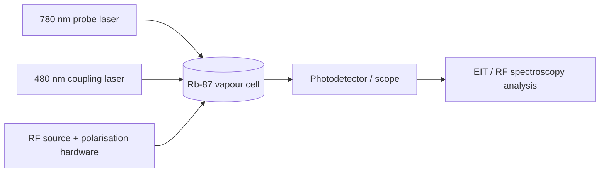

# Laboratory hardware, materials and build records

The inventory is based on the experimental report, optical-chain diagrams and project design records. **Inventory identification is not proof of ownership or procurement.** The [BOM CSV](../operations/BOM.csv) differentiates observed/reported apparatus, design candidates and quotations.

### Primary subsystems

- **Atomic/optical:** 87Rb vapour cell; 780 nm DL PRO probe and 480 nm coupling system; beam optics, coupling/fiber components, photodetector and oscilloscope.
- **RF polarisation:** LPDA RF antenna, external RF source and a linear polariser; antenna-based circular-polarisation options investigated.
- **Magnetic-field workstream:** Helmholtz coils and power supply in the interim calibration-stage work; magnetic bias is not required to describe the subsequent HFSS full-Stokes design.
- **Fabrication development:** double-sided copper PCB concepts, substrate selection, artwork, etched copper features and electronic switching options.

### Safe restart check

Before any physical test, reconcile every item against the laboratory's live asset register, equipment manuals, laser safety rules, RF exposure guidance, optical alignment SOP and supervisor-approved experimental procedure. Do not energise laser/RF systems from this inventory alone. Check detector power ratings, interlocks, beam dumps and calibration certificates.

See [experimental SOP](../methods/EXPERIMENTAL_SOP.md) and [equipment/procurement status](../operations/PROCUREMENT.md).
