# Information-aware RF metasurface analyser

## Architecture

The paper evaluates a **two-layer, switch-programmable copper metasurface** as a set of six polarisation-selective measurements driving a fixed receiver axis. An electromagnetic configuration is useful when its receiving response is sensitive to sufficiently independent projections of incident field polarisation.

```mermaid
flowchart LR
  A[Incident Jones field Ex, Ey] --> B[Two-face reconfigurable copper geometry]
  B --> C[Six switched RF analyser states]
  C --> D[HFSS complex local electric field]
  D --> E[State-dependent quadratic observables]
  E --> F[6 × 4 Stokes instrument matrix]
  F --> G[Rank / κ2 / gain / mesh verification]
  G --> H[Stokes inference and next-stage Rb calibration]
```

## RF/mathematical chain

For complex Jones field `E = [Ex, Ey]ᵀ`, one conventional Stokes sign convention is `S0=|Ex|²+|Ey|²`, `S1=|Ex|²-|Ey|²`, `S2=2Re(Ex Ey*)`, `S3=2Im(Ex Ey*)`. **S3 sign changes under some handedness/convention definitions**; use the sign and detector basis defined in the manuscript when reproducing its figures.

Each switching state supplies a measurement row `a_i` such that `y_i = a_i S`. Stack the six rows into `A` (6 × 4). Full column rank makes the four-dimensional inversion identifiable in that observation model. A low condition number reduces worst-direction amplification, but rank and conditioning alone are not proof of atomic calibration transfer.

## Hardware parameters: distinguish stages

| Item | Documented design context |
|---|---|
| Two-face copper structure | Switchable metasurface, electromagnetic solver evaluation |
| Six analyser observations | Independent electrical configurations used to construct the instrument |
| Frequency of reported selected periodic case | 1.925 GHz |
| Finite verification | 3 × 3 HFSS model in final manuscript |
| Laboratory receiver optical wavelengths | 780 nm probe and 480 nm coupling |
| Historical physical aperture constraint | Rb cell interrogation region approximately 70 × 50 mm; separate PCB-design exploration includes 200 × 200 mm |
| Candidate substrate values in prior studies | Rogers RO4350B ~1.52 mm, 35 µm copper, among other geometry branches; **do not mix branch-specific dimensions** |
| Switching model | Ideal conducting switching in electromagnetic simulations; do not infer completed PIN-diode assembly |

For exact final copper dimensions, state definitions and optimisation setup, read [the manuscript](../../papers/manuscript-source/main.tex), geometric figures and archived HFSS source JSON. Earlier PCB layouts and conceptual designs must not be presented as the final simulated geometry.

## Engineering verification criteria

- Check exact geometry, metal/substrate properties, ports, boundary conditions, polarization excitations and export plane.
- Export **complex** electric-field components; preserve `Ex, Ey, Ez`, phase, frequency and all state identifiers.
- Reconstruct the polarimetric basis and verify rank, singular spectrum, gain, conditioning and independent solver mesh agreement.
- Compare periodic-cell findings with finite-aperture behaviour. Preserve the reported mesh dependence and circular sensitivity caveats in all technical interpretations.
- Record native `.aedt` projects separately when supplied; current archive provides preserved solver-return evidence and scripts, not a complete native project database.
