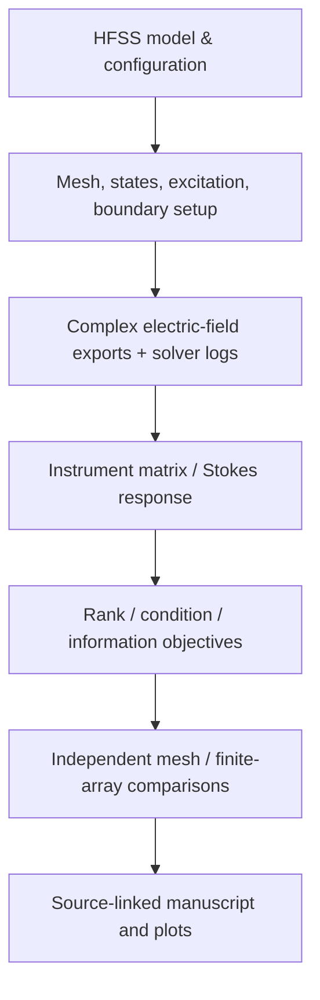

# Source-backed evidence catalogue

The archive includes the genuine **V44 research reproducibility evidence bundle** expanded into [`evidence/hfss/v44-reproducibility`](../../evidence/hfss/v44-reproducibility/). Its native-return ZIP files are retained byte-for-byte as imported; the accompanying CSV, JSON, scripts and source hashes remain addressable independently.

| Evidence family | Path | What it supports |
|---|---|---|
| HFSS numerical data | [`data/`](../../evidence/hfss/v44-reproducibility/data/) | Complex field exports, instrument matrices, mesh checks, finite distance and case summaries |
| Source archives | [`source_evidence/`](../../evidence/hfss/v44-reproducibility/source_evidence/) | Preserved compact original HFSS-return bundle, accompanying mixed-result archive |
| Verification/analysis code | [`analysis/`](../../evidence/hfss/v44-reproducibility/analysis/) | Derivation, figure regeneration, information geometry, fixed-time allocation checks |
| Analysis figure provenance | [`FIGURE_PROVENANCE.json`](../../evidence/hfss/v44-reproducibility/data/FIGURE_PROVENANCE.json) | Old publication-figure-to-source mapping |
| Independent mesh datasets | [`HFSS_V15_independent_mesh.csv`](../../evidence/hfss/v44-reproducibility/data/HFSS_V15_independent_mesh.csv) | Mesh-comparison metrics in historical study |
| Source hashes | [`SOURCE_HFSS_CHECKSUMS.json`](../../evidence/hfss/v44-reproducibility/data/SOURCE_HFSS_CHECKSUMS.json) | Native HFSS evidence provenance |
| Article simulation matrix | [`V42_C033_INSTRUMENT_MATRIX.csv`](../../papers/manuscript-source/data/V42_C033_INSTRUMENT_MATRIX.csv) | Six analyser rows × four Stokes coefficients |
| State subset comparison | [`V44_FIXED_BUDGET_ALL_SUBSETS.csv`](../../papers/manuscript-source/data/V44_FIXED_BUDGET_ALL_SUBSETS.csv) | Offline information and allocation calculations |
| Paper figure generator | [`rebuild_verified_figures.py`](../../papers/manuscript-source/figure_source/rebuild_verified_figures.py) | Figure derivation from bundled numerical inputs |
| Current paper | [`current-manuscript-draft.pdf`](../../papers/current-manuscript-draft.pdf) | Selected narrative, equations and scientific interpretations |

**Important provenance distinction:** a compact HFSS export/return is *not* equivalent to a full native HFSS `.aedt` project. The imported compact return contains solver logs, convergence files, field and result records, not a complete set of locally reopenable native AEDT projects. Source `.aedt` databases and raw experimental acquisition files should be added in future releases if available and cleared.

## Reproducible evidence trail

The [`CLAIM_EVIDENCE.csv`](../traceability/CLAIM_EVIDENCE.csv) maps every headline numerical result to its source, method and limits. The [`ASSET_REGISTER.csv`](../traceability/ASSET_REGISTER.csv) contains package-wide file paths, sizes, SHA-256 hashes and types.
