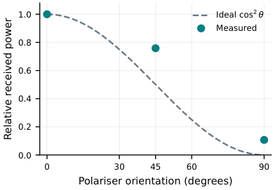

# Experimental workstream: optics, RF and calibration

## Work covered

The June 2026 technical report describes experimental characterisation of RF antennas and a custom polariser using a vector network analyser, magnetic-field calibration and exploratory optical Rydberg microwave readout. The main receiver uses a rubidium-vapour cell, a 780 nm probe laser, a 480 nm coupling laser, photodetection and a microwave input path.

### Linear-polarisation response

The interim RF reference polariser was reported near **14–15 dB** pass/reject discrimination. Later experimental polarisation figures refer to approximately **9.7 dB** under another measurement arrangement. Always preserve measurement setups, instrument settings, frequency, polarization angle, plotted metric and normalisation together with a reported contrast.

*Figure: experimental linear-polarisation response, reproduced from the original manuscript figure asset; not a generated HFSS sweep.*

### Additional experimental content

- RF antenna co- / cross-polar comparisons and VNA measurements.
- Helmholtz-coil magnetic calibration and initial bias-dependent optical/RF observations.
- Hardware conditioning, optical beam geometry and photodetector readout considerations.
- Poincaré-equator conceptual reconstruction from linear analyzer orientations.

## Experimental archive locations

| Artefact | Link | Use |
|---|---|---|
| June 2026 experimental-stage report | [PDF](../../reports/2026-06-magnetically-biased-rydberg-receiver.pdf) | Reference protocol, figures, physics and reported measurements |
| Polarisation equator illustration | [PNG](../../presentations/linear-polarisation-poincare-equator.png) | Explaining linear-polarisation Stokes components |
| Rydberg research poster | [PNG](../../presentations/rydberg-receiver-research-poster.png) | Research communication and broader setup |
| ARC scientific script | [Python](../../research-code/arc/rydberg_tqe_advanced_poster_simulations.py) | Quantum/transition simulation and figure source as historically supplied |

Raw oscilloscope waveforms, wavelength scans, independent trial spreadsheets and original VNA `.s2p` data were not separately present among the imported records. See [intake list](../handover/HANDOVER.md) for adding them with true acquisition metadata if available.
