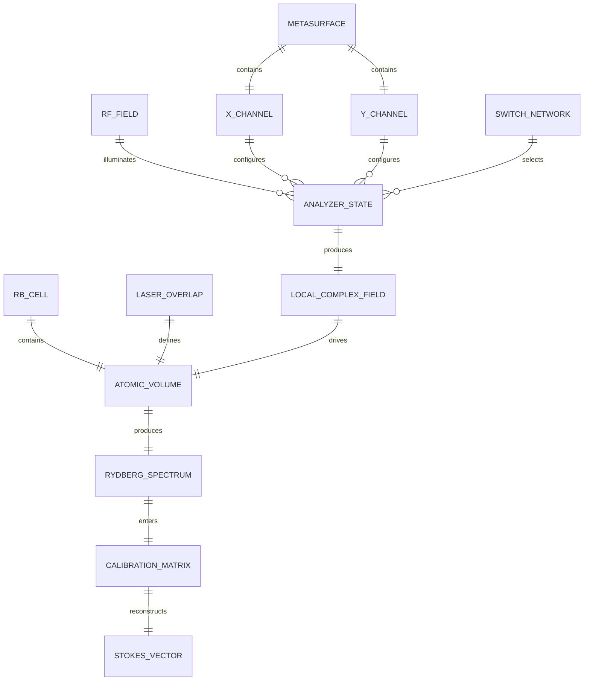
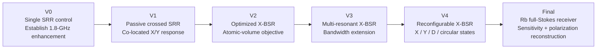

> **Archive status: Original engineering design study. Not a validated as-built board or a final HFSS project.**
>
> Source: user's historical research Library file: **70 × 50 mm X-BSR design basis** (2026-09-28). Imported as original text extracted from the saved research document; embedded sandbox links or old source markers may be inactive. Distinguish *proposed* from verified results. Underlying source JSON/attachments can be separately recovered for exact byte-level archival.

---

# Design Basis for a 70 × 50 mm PCB X-BSR Metasurface for Rydberg RF Polarimetry

## Executive summary

The most defensible starting architecture for this thesis is **not** a large periodic metasurface array. At 1.8 GHz, the free-space wavelength is approximately \(166.7\) mm, so a \(70\times50\) mm board is only \(0.42\lambda_0\times0.30\lambda_0\). There is insufficient aperture to build a conventional array of many weakly coupled subwavelength cells while simultaneously leaving each cell large enough to generate strong resonant enhancement at 1.8 GHz. The better starting point is a **finite, electrically compact crossed resonant sheet consisting of two orthogonal bow-tie-loaded split-loop/SRR channels on opposite PCB faces**, hereafter the **X-BSR**. Later versions can add parasitic resonators or smaller meta-atoms and legitimately move toward a multi-cell metasurface.

The recommendation is therefore:

> **Build V1 around one co-located dual-polarization resonator: an X-sensitive bow-tie-loaded split loop on L1 and the identical geometry rotated \(90^\circ\) on L2, with both capacitive gaps projected onto the same Rb interrogation volume. Use a 0.508-mm RO4003C substrate, 1-oz copper, no ground plane, approximately 1.2-mm inductive traces, a 0.6-mm capacitive gap, 7-mm linear tapers, 1-mm tip width, and 6-mm taper-base width as the first full-wave seed.**

Those dimensions are **initial optimization coordinates, not a claim that the unsimulated board will resonate exactly at 1.8 GHz**. The first simulation sweep should cover approximately 0.8–3 GHz and retune the inductive path and gap capacitance until the **loaded PCB + glass vapor-cell system**, rather than the isolated PCB, resonates at 1.8 GHz.

There is strong justification for using the split-resonator family. Holloway *et al.* demonstrated a subwavelength SRR incorporated with an atomic vapor cell at 1.3 GHz and reported a factor-of-100 improvement in Rydberg E-field measurement sensitivity, reducing the demonstrated minimum detectable field from \(500\) to \(5\) mV/m; with heterodyne detection they reported \(5.5~\mu\text{V m}^{-1}/\sqrt{\text{Hz}}\). Anderson *et al.* had already demonstrated an Rb vapor-cell sensor with a polarization-selective resonator and a 24-dB improvement in intensity sensitivity, including spatial characterization of the enhanced field. Thus, **“SRR-enhanced Rydberg sensing” and “polarization-selective resonator + Rb” are prior art**; neither is sufficient novelty by itself.

The design objective should also be changed from “maximize the largest simulated \(|E|\)” to **maximize the field actually sampled by the atoms**:

\[
F_p(f)=
\frac{
\int_{V_a} W(\mathbf r)
\left|
\hat{\mathbf e}_p\cdot\mathbf E(\mathbf r,f)
\right|\,dV
}{
E_0\int_{V_a}W(\mathbf r)\,dV
},
\]

where \(W(\mathbf r)\) represents the optical interrogation weighting. A \(100\times\) hotspot occupying tens of micrometres is less useful than a \(10\times\) enhancement that is nearly uniform across the approximately \(0.5\)-mm laser waist. Recent full-wave modeling of Rydberg vapor cells further shows that the glass-cell geometry, incidence angle and polarization can themselves substantially modify the RF field, making inclusion of the cell in optimization mandatory rather than optional. The proposed \(1.2\)–\(2.4\) GHz candidate band corresponds to a **66.7% fractional bandwidth about 1.8 GHz**. It should be treated as a stretch goal for the **union of reconfigurable states**, not as the V1 requirement for one high-enhancement passive resonance. Recent Rydberg-enhancement work has resorted to mechanical tuning or cascaded resonances to obtain broad frequency coverage, which is consistent with the fundamental enhancement–bandwidth tension of strongly resonant structures. Most importantly, the eventual novelty should be **full-Stokes atomic polarimetry**, not merely switchable \(X/Y\) analysis. A Chinese patent, CN121805693A, filed March 12 and published April 7, 2026, explicitly describes a dual-frequency PIN-diode reconfigurable metasurface placed between an RF source and a Rydberg vapor cell, with orthogonal structures on the two substrate faces switched to select the \(x\)- or \(y\)-polarized component and reconstruct linear polarization angle. The defensible progression is therefore

\[
X,Y
\quad\rightarrow\quad
X,Y,+45^\circ
\quad\rightarrow\quad
X,Y,+45^\circ,\mathrm{RCP/LCP}
\quad\rightarrow\quad
(S_0,S_1,S_2,S_3).
\]

Full arbitrary microwave polarization has already been demonstrated directly with Rb Rydberg atoms to approximately \(0.5^\circ\) resolution, so the scientific opportunity is not to establish that atoms can sense polarization, but to show that a **co-designed planar RF structure improves sensitivity while converting a simple atomic readout into a well-conditioned, reconfigurable full-Stokes receiver**. My recommendation is consequently to treat the paper as a **co-design problem among RF resonator, vapor-cell electromagnetics, optical interrogation volume, and polarimetric inverse problem**, rather than as an antenna-design exercise.

## Architecture and electromagnetic rationale

### Coordinate system and physical arrangement

Fix the coordinate system now and use it throughout CST/HFSS, PCB CAD, the thesis and the eventual AIP manuscript:

\[
x:\;\text{70-mm PCB dimension},
\qquad
y:\;\text{50-mm PCB dimension},
\qquad
z:\;\text{RF propagation direction}.
\]

The first simulation assumes a normally incident plane wave propagating in \(+z\). The metasurface is at \(z=0\); the Rb cell is immediately behind it. The nominal \(X\) channel is the structure whose central capacitive gap responds most strongly to incident \(E_x\); the \(Y\) channel is the same resonator rotated \(90^\circ\).

The PCB and cell should be centered in \(x,y\). The laser coordinate should be kept separate from the RF coordinate: let \(\hat{\mathbf s}\) denote the optical propagation axis. Until the real experiment is measured, I would **not assume that \(\hat{\mathbf s}=\hat x\) or \(\hat y\)** in the optimization code. Make it a model parameter.

The figure is a **topological seed rather than a Gerber mask**. Electrically, each channel should be constructed as a symmetric capacitively loaded split loop: the two bow-tie end caps form the central split, while inductive return traces connect around the outside. This retains the useful LC physics of an SRR while deliberately moving the strong capacitive field to the board center.

That distinction matters. A conventional square SRR generally produces its strongest electric field at a split on its perimeter. For the Rydberg system, the useful hotspot should instead coincide with the probe/coupling-laser overlap. Holloway *et al.* demonstrated that a split resonator can provide very large Rydberg sensitivity enhancement at 1.3 GHz, while Anderson *et al.* showed that the spatial RF mode inside a polarization-selective Rb resonator directly matters to sensor performance. The X-BSR takes those observations as the baseline and adds **centralized, dual-polarization field concentration**.

### Why opposite PCB faces

The first passive device should use:

\[
\text{L1: X-BSR}
\]

\[
\text{dielectric core}
\]

\[
\text{L2: Y-BSR}.
\]

There should be **no continuous ground plane**.

Placing the channels on opposite faces prevents a galvanic short at the crossing and provides a compact way of co-locating the two analyzer channels. The penalty is interlayer capacitive and inductive coupling. That coupling is not necessarily undesirable: later, controlled coupling between \(X\) and \(Y\) is precisely what can generate the relative phase required for diagonal and circular analyzer states. But for V1 it should be minimized enough that the two linear channels remain approximately degenerate and orthogonal.

This means substrate thickness \(h\) is not just a fabrication parameter. It is an optimization variable:

\[
h\uparrow
\quad\Rightarrow\quad
\text{typically weaker interlayer coupling but larger physical layer asymmetry},
\]

whereas

\[
h\downarrow
\quad\Rightarrow\quad
\text{more nearly co-located X/Y planes but stronger mutual coupling}.
\]

For that reason I recommend **0.508 mm as the first RO4003C core**, then explicitly compare \(0.406,\;0.508,\;0.813\) mm in simulation. PCBWay presently lists all of those thicknesses for Rogers 4003C. ### Why bow-tie loading

The bow-tie is not being added because “bow ties are inherently better antennas.” Its purpose here is much narrower: give us independent control of

\[
C_\mathrm{gap},\qquad
E_\mathrm{gap},\qquad
\nabla E_\mathrm{gap},
\]

without changing the complete outer inductive path every time.

The important geometric variables are:

\[
g,\quad
w_t,\quad
w_b,\quad
l_t,\quad
\alpha,
\]

where \(g\) is the tip gap, \(w_t\) the truncated-tip width, \(w_b\) the taper-base width, \(l_t\) the taper length, and

\[
\alpha =
2\tan^{-1}
\left(
\frac{w_b-w_t}{2l_t}
\right)
\]

is the included flare angle.

A very sharp, tiny-gap bow tie will probably win an optimization based on

\[
\max_{\mathbf r}|E(\mathbf r)|,
\]

but may lose badly when judged on

\[
\left\langle |E|\right\rangle_W
\]

and field variance across the atoms. That is exactly the sort of distinction from which the paper can obtain useful physics rather than simply reporting a resonant PCB.

### The vapor cell belongs inside the EM model

For the seed model, represent the Rb vapor itself as approximately vacuum/air electromagnetically and treat the **glass envelope as the dominant bulk dielectric perturbation**. Do not yet assign a supposedly precise glass permittivity without identifying the actual cell material.

Use the following uncertain cell parameters initially:

\[
\epsilon_{r,g}=3.5\text{–}5.0,
\]

\[
t_g=0.5\text{–}2.0~\mathrm{mm},
\]

\[
d_\mathrm{cell}=5\text{–}25~\mathrm{mm},
\]

and measure the real values before locking the board.

Those are deliberately broad **simulation assumptions**, not claimed properties of your cell. Full-vector FEM work on Rydberg vapor cells has found substantial frequency-, angle-, polarization- and geometry-dependent RF structure associated with the cell itself, including strong resonant effects in structured all-glass cells. Therefore, optimizing the PCB in free space and adding the cell at the end would be methodologically weak.

The PCB-to-glass separation should start at

\[
s_{pc}=1~\mathrm{mm}
\]

and be swept over roughly \(0\)–\(5\) mm.

Even more important is

\[
z_a =
\text{distance from PCB to the actual optical/atomic interrogation volume}.
\]

This quantity should be measured before fabrication of an optimized board. A spectacular field directly at the copper gap is irrelevant if the atoms are sampled \(8\) or \(10\) mm farther back.

### The system should be modeled as a transfer matrix

Rather than treating \(X\) and \(Y\) simulations independently, define the complex local transfer matrix

\[
\begin{bmatrix}
\overline E_x\\[3pt]
\overline E_y
\end{bmatrix}
=
\mathbf H(f)
\begin{bmatrix}
E_{x,\mathrm{inc}}\\[3pt]
E_{y,\mathrm{inc}}
\end{bmatrix},
\]

where

\[
\overline E_i =
\frac{\int W(\mathbf r)E_i(\mathbf r)\,dV}
{\int W(\mathbf r)\,dV}.
\]

Thus

\[
\mathbf H(f)=
\begin{bmatrix}
H_{xx} & H_{xy}\\
H_{yx} & H_{yy}
\end{bmatrix}.
\]

For an ideal linear \(X\)-analyzer state,

\[
|H_{xx}|\gg|H_{xy}|,
\]

whereas the \(Y\) state should produce the corresponding orthogonal relationship.

This matrix formulation becomes extremely useful later because **full polarization reconstruction requires phase as well as amplitude**. Merely obtaining large \(|E_x|\) and \(|E_y|\) cannot distinguish two elliptical states having the same component magnitudes but opposite relative phase.

The component relationships are naturally summarized as:

That is, the end product is not fundamentally “a metasurface followed by a sensor.” It is one calibrated measurement system.

## Parameterized geometry and PCB implementation

### Seed geometry

The following is the layout I would actually put into the first parameterized CAD model.

| Parameter | Symbol | Initial value | First optimization range | Purpose |
|---|---:|---:|---:|---|
| PCB width, \(x\) | \(W_B\) | 70 mm | fixed | Match 7-cm cell aperture |
| PCB height, \(y\) | \(H_B\) | 50 mm | fixed | Match 5-cm cell aperture |
| Substrate thickness | \(h\) | **0.508 mm** | 0.406–0.813 mm | X/Y coupling |
| Copper thickness | \(t_\mathrm{Cu}\) | 35 µm, 1 oz | fixed initially | Standard robust copper |
| X-channel long envelope | \(L_u\) | **40 mm** | 32–46 mm | Inductance/resonance |
| X-channel transverse envelope | \(L_v\) | **36 mm** | 28–44 mm | Inductance/coupling |
| Y-channel envelope | — | X geometry rotated 90° | symmetry constrained | Equal X/Y response |
| Main trace width | \(w_r\) | **1.2 mm** | 0.8–2.0 mm | Loss, inductance, Q |
| Central capacitive gap | \(g\) | **0.60 mm** | 0.30–1.20 mm | Capacitance/E enhancement |
| Bow-tie tip width | \(w_t\) | **1.0 mm** | 0.5–2.5 mm | Hotspot size |
| Bow-tie base width | \(w_b\) | **6.0 mm** | 4–10 mm | Effective capacitance |
| Taper length | \(l_t\) | **7.0 mm** | 4–10 mm | Field spreading |
| Included flare angle | \(\alpha\) | **39.3°** | roughly 25–60° | Concentration/uniformity |
| Outer-corner radius | \(r_c\) | 1.0 mm | 0–3 mm | Current crowding/tuning |
| X/Y angular separation | — | 90° | fixed V1/V2 | Orthogonal analysis |
| X/Y in-plane offset | \(\Delta x,\Delta y\) | 0, 0 | ±2 mm | Coupling correction |
| PCB–glass spacing | \(s_{pc}\) | **1.0 mm** | 0–5 mm | Coupling to cell |
| Assumed beam radius | \(w_0\) | **0.5 mm** | 0.25–1.0 mm robustness | Atomic averaging |
| Glass-wall thickness | \(t_g\) | 1.0 mm seed | 0.5–2.0 mm | Cell perturbation |
| Cell interior depth | \(d_c\) | 10 mm seed | 5–25 mm | Field penetration |
| Ground plane | — | **none** | fixed V1/V2 | Transmission/local field |
| Vias in resonator | — | **none** | fixed V1/V2 | Preserve symmetry |

For the baseline dimensions,

\[
\alpha =
2\tan^{-1}\left(\frac{6-1}{2(7)}\right)
\approx39.3^\circ.
\]

The roughly \(40\times36\) mm resonator envelope corresponds to approximately

\[
0.24\lambda_0 \times 0.22\lambda_0
\]

at 1.8 GHz. The LC loading is consequently essential; the outer dimensions alone are not intended to correspond to a simple half-wave resonance.

### Actual copper topology

Each resonator should be one continuous conductor interrupted only by the central capacitive gap.

For the \(X\) channel:

1. Place two truncated bow-tie end caps symmetrically on the \(x\) axis, separated by \(g\).
2. Each taper expands over \(l_t\) from \(w_t\) to \(w_b\).
3. Continue each taper outward through a \(w_r\)-wide neck toward the left/right return rail.
4. Use upper and lower \(w_r\)-wide return rails to provide the inductive current path around the gap.
5. Preserve mirror symmetry about both axes wherever possible.
6. Put the corresponding \(Y\) resonator on L2 by rotating the complete geometry \(90^\circ\).

A useful initial neck length is approximately

\[
l_n=
\frac{L_u-g}{2}-l_t
\approx
12.7~\mathrm{mm}.
\]

What should **not** be done in V1 is to add PIN diodes, bias lines, vias, SMA feeds, ground planes, lumped capacitors and multiple nested resonances simultaneously. That would prevent you from determining which mechanism is responsible for any improvement.

### Bow-tie candidates

I would fabricate or at least simulate three bow-tie variants with the **same outer inductive loop**.

| Geometry | \(g\) | \(w_t\) | \(w_b\) | \(l_t\) | \(\alpha\) | Expected role |
|---|---:|---:|---:|---:|---:|---|
| **Balanced linear taper — B1** | **0.60 mm** | **1.0 mm** | **6 mm** | **7 mm** | **39.3°** | Recommended baseline; compromise between enhancement, volume and tolerance |
| **Sharp high-field taper — B2** | 0.30 mm | 0.5 mm | 8 mm | 8 mm | 50.2° | Upper bound on peak field; likely strongest spatial nonuniformity and dimensional sensitivity |
| **Broad truncated taper — B3** | 1.00 mm | 2.0 mm | 7 mm | 6 mm | 45.2° | Lower peak field but potentially superior waist-averaged uniformity and bandwidth |

The table deliberately says **expected**, not predicted. Which design is best should be determined from

\[
\langle |E|\rangle_W
\quad\text{and}\quad
\mathrm{CV}(|E|),
\]

not from intuition.

The sharp B2 geometry is important scientifically even if it loses. If B2 produces \(30\times\) peak field but only \(7\times\) atomic-volume average while B3 produces \(12\times\) peak and \(10\times\) average with substantially less inhomogeneous broadening, that is exactly the kind of optimization result worth publishing.

Strong localized gap enhancement is a well-established SRR phenomenon, including recent microwave demonstrations using an SRR to create submillimetre high-field regions. The research question for this project is therefore not whether the gap produces a hotspot, but **what hotspot geometry maximizes useful atomic signal**.

### Substrate comparison

PCBWay's current quotation interface lists FR-4 and Rogers materials, specifically `Rogers4003C` and `Rogers4350B`, while its API gives available Rogers core thicknesses. It also lists `S1000H TG150` among its FR-4 options. Rogers specifies \(D_k=3.38\pm0.05\) and \(D_f=0.0027\) at 10 GHz for RO4003C, and \(D_k=3.48\pm0.05\), \(D_f=0.0037\) at 10 GHz for RO4350B; RO4350B is also UL94 V-0 rated. | Option | PCBWay material selection | Relevant available thicknesses | RF model basis | Assessment for this project |
|---|---|---|---|---|
| **RO4003C** | `Rogers4003C` | 0.203, 0.305, 0.406, **0.508**, **0.813**, 1.524 mm | \(D_k=3.38\pm0.05\), \(D_f=0.0027\) at 10 GHz | **Recommended V1/V2**. Controlled dielectric properties, low loss, FR-4-compatible fabrication |
| **RO4350B** | `Rogers4350B` | 0.101, 0.168, 0.254, 0.338, 0.422, **0.508**, **0.762**, 1.524 mm | \(D_k=3.48\pm0.05\), \(D_f=0.0037\) at 10 GHz | Excellent final active-board candidate; slightly more loss than 4003C but attractive for populated/reconfigurable hardware |
| **High-Tg FR-4** | `S1000H TG150` | PCBWay standard FR-4 thickness menu includes thin through conventional board values | **Do not assume a precise GHz \(D_k\)/\(D_f\) without vendor lot data or measurement** | Good cheap control board; weaker choice for the paper's optimized reference device because resonance reproducibility matters |

PCBWay presently advertises its full-feature process down to **2/2 mil trace/space**, while its standard/basic capability shows 4/4 mil and its quotation API exposes design choices beginning at 3/3 mil with hole-size choices as small as 0.15 mm. There is no reason for this research PCB to operate anywhere near those limits.

I would impose our own much more conservative design rules:

\[
w_\mathrm{min}=0.30~\mathrm{mm}
\]

for any RF trace,

\[
s_\mathrm{min}=0.25\text{–}0.30~\mathrm{mm},
\]

and, when active circuitry is eventually added,

\[
d_\mathrm{via}=0.30~\mathrm{mm},
\qquad
d_\mathrm{pad}\approx0.60~\mathrm{mm}.
\]

The baseline \(0.6\)-mm bow-tie gap is therefore very comfortable to manufacture. Even the aggressive \(0.3\)-mm gap is not an exotic feature for PCBWay relative to its published limits. ### Recommended PCB stack

My V1/V2 order specification would be:

| Item | Recommendation |
|---|---|
| Dimensions | **70.0 × 50.0 mm** |
| Layers | **2** |
| Core | **Rogers RO4003C, 0.508 mm** |
| L1 | 1-oz Cu, X-BSR |
| L2 | 1-oz Cu, Y-BSR |
| Ground | **None** |
| Copper pours | **None in RF aperture** |
| Vias | **None in passive prototypes** |
| Solder mask | **Remove over complete resonant aperture** |
| Silkscreen | Outside active \(60\times40\) mm region only |
| Finish | Prefer immersion silver or another thin finish with minimal stack uncertainty; quote-confirm the exact Rogers/finish combination |
| Impedance control | Not required for passive board |
| Board number/date code | Outside resonant region |
| Mounting | Prefer nonmetallic external fixture rather than metal screws through active aperture |

PCBWay's present ordering system lists no-solder-mask as an option and includes HASL, immersion gold, immersion silver, immersion tin, OSP and other finishes. RO4003C is my first choice because its dielectric constant is controlled much more tightly than a generic FR-4 model and Rogers explicitly positions it for cost-sensitive microwave/RF applications. The substrate decision could itself be a useful supplementary result: fabricate identical B1 devices in FR-4 and RO4003C and compare frequency shift, Q and repeatability.

## Simulation, optimization and full-Stokes reconstruction

### Full-wave simulation hierarchy

The first model should be the **finite 70 × 50 mm board**, not a periodic unit cell with Floquet boundaries.

The preferred simulation path is:

**Primary model:** CST Microwave Studio or Ansys HFSS, finite structure, plane-wave excitation, open/PML boundaries.

**Cross-check:** COMSOL RF Module for the final one or two designs, particularly because volume integrations and arbitrary weight functions are convenient in FEM.

The Rydberg-cell literature already makes substantial use of full-wave/FEM simulation because cell geometry can significantly modify internal fields. Use the following sequence.

**Electromagnetic domain**

\[
f=0.8\text{–}3.0~\mathrm{GHz}
\]

for discovery, before narrowing to the candidate \(1.2\)–\(2.4\) GHz band.

The wide initial sweep is essential because loading by the second resonator and by the glass cell may move the resonance far from the nominal 1.8-GHz seed.

Excitation:

\[
\mathbf k=k\hat z,
\qquad
E_0=1~\mathrm{V/m}.
\]

Run at minimum:

\[
X,\quad
Y,\quad
+45^\circ,\quad
-45^\circ,\quad
\mathrm{RCP},\quad
\mathrm{LCP}.
\]

For robustness, repeat the final designs at incidence angles

\[
\theta=0^\circ,\pm15^\circ,\pm30^\circ.
\]

Angle dependence is worth testing even though normal incidence is the design assumption because full-wave vapor-cell calculations show that internal fields can depend strongly on angle and polarization. ### Mesh requirements

Use finite-conductivity copper rather than PEC for final optimization.

At the bow-tie gap, target approximately 6–10 mesh cells across the smallest relevant feature. For the 0.6-mm B1 gap this implies local dimensions on the order of

\[
60\text{–}100~\mu\mathrm m.
\]

For the aggressive 0.3-mm B2 device, local refinement must be correspondingly finer.

Also refine throughout the \(0.5\)-mm atomic-volume region. The convergence criterion should not merely be \(|S_{21}|\); require convergence of

\[
f_r,\qquad
F,\qquad
\mathrm{PER},\qquad
\mathrm{CV}
\]

to approximately a few percent or better.

### Atomic-volume weighting

For the present assumed waist,

\[
w_0=0.5~\mathrm{mm},
\]

use

\[
W(\rho)=
\exp\left(-\frac{2\rho^2}{w_0^2}\right)
\]

as the first approximation.

Once the actual probe and coupling waists are known, replace it with the product of their optical weighting functions:

\[
W(\mathbf r)\propto
I_p(\mathbf r)I_c(\mathbf r),
\]

possibly including axial probe attenuation.

For every incident polarization calculate both

\[
F_{1,p}=
\frac{
\left\langle |E_p|\right\rangle_W
}{E_0}
\]

and

\[
F_{2,p}=
\frac{
\sqrt{\left\langle |E_p|^2\right\rangle_W}
}{E_0}.
\]

The first is more closely connected to a spatially averaged amplitude response; the second characterizes local field energy. Reporting both avoids hiding very nonuniform fields behind an RMS number.

Define the field coefficient of variation as

\[
\mathrm{CV}_p=
\frac{
\sqrt{
\left\langle
\left(|E_p|-\langle|E_p|\rangle_W\right)^2
\right\rangle_W
}
}{
\langle|E_p|\rangle_W
}.
\]

Low \(\mathrm{CV}\) is important because spatially varying Rabi frequency translates into spatially varying local Autler–Townes response and can ultimately broaden or distort the spatially integrated spectrum. The direct Rydberg/resonator literature already emphasizes spatial field structure as a relevant observable. ### Polarization extinction

For the nominal \(X\) state define

\[
\mathrm{PER}_X=
20\log_{10}
\left[
\frac{
F_{X\leftarrow X}
}{
F_{X\leftarrow Y}
}
\right].
\]

Likewise,

\[
\mathrm{PER}_Y=
20\log_{10}
\left[
\frac{
F_{Y\leftarrow Y}
}{
F_{Y\leftarrow X}
}
\right].
\]

The \(20\log_{10}\) definition is appropriate because \(F\) here is a field-amplitude ratio. If a power/intensity PER is subsequently quoted, use \(10\log_{10}\) and explicitly label it.

Also monitor channel balance:

\[
\Delta G_{XY}
=
20\log_{10}\frac{F_X}{F_Y}.
\]

A device with \(30\) dB PER but an 8-dB gain difference between X and Y is not a particularly attractive polarimeter.

### Defining “usable bandwidth”

Do **not** define bandwidth only from a scattering-parameter \(-3\)-dB width.

Define the Rydberg-relevant usable set as

\[
\mathcal B=
\left\{
f:
F_{\min}(f)\ge F_\mathrm{thr},
\;
\mathrm{PER}_{\min}(f)\ge P_\mathrm{thr},
\;
\mathrm{CV}_{\max}(f)\le U_\mathrm{thr},
\;
\kappa[\mathbf A(f)]\le K_\mathrm{thr}
\right\}.
\]

Then

\[
\mathrm{FBW}=
\frac{f_H-f_L}
{(f_H+f_L)/2}.
\]

For \(1.2\)–\(2.4\) GHz,

\[
\mathrm{FBW}
=
\frac{2.4-1.2}{1.8}
=
66.7\%.
\]

That is a **very demanding requirement for one strongly field-enhancing passive resonance**. Holloway's demonstrated device was resonant around one 1.3-GHz transition, while more recent broadband Rydberg enhancement work has introduced mechanical tuning or cascaded resonators to extend frequency coverage. The sensible paper strategy is therefore to demonstrate progressively:

\[
\text{strong single-frequency enhancement}
\rightarrow
\text{passive multi-resonance}
\rightarrow
\text{switchable/tunable coverage}.
\]

### Optimization variables and objective

The first design-of-experiments vector should be

\[
\mathbf x=
[
L_u,L_v,w_r,g,w_t,w_b,l_t,h,s_{pc},z_a
].
\]

Do not optimize all variables immediately. Start with sensitivity sweeps around

\[
L_u,\;g,\;l_t,\;h,\;z_a.
\]

Then run a multiobjective optimizer.

The core objectives are

\[
\max F_{\mathrm{avg}},
\]

\[
\max\mathrm{PER},
\]

\[
\min\mathrm{CV},
\]

\[
\max\mathrm{FBW},
\]

and later

\[
\min\kappa(\mathbf A).
\]

I would keep this as a **Pareto optimization** initially rather than hiding the tradeoffs inside one arbitrary weighted scalar. Once the Pareto front is understood, a robust scalar objective can be defined, for example

\[
J =
w_F\ln F_{\min}
+
w_P\frac{\mathrm{PER}_{\min}}{20}
-
w_U\mathrm{CV}_{\max}
-
w_\kappa\ln\kappa(\mathbf A)
-
P_\mathrm{constraints}.
\]

Optimization should then be repeated under dimensional and dielectric perturbations. A nominal optimum sitting on an extremely sharp resonance may be inferior to a slightly weaker geometry whose performance survives substrate, gap and cell-spacing errors.

### From X/Y sensing to full Stokes

The final paper becomes substantially stronger if the metasurface implements four independent polarization projections.

For incident Stokes vector

\[
\mathbf S=
\begin{bmatrix}
S_0&S_1&S_2&S_3
\end{bmatrix}^{T},
\]

the intuitive analyzer set is

\[
X,\qquad
Y,\qquad
D=+45^\circ,\qquad
R=\mathrm{RCP}.
\]

For ideal power measurements,

\[
I_X=\frac{S_0+S_1}{2},
\]

\[
I_Y=\frac{S_0-S_1}{2},
\]

\[
I_D=\frac{S_0+S_2}{2},
\]

\[
I_R=\frac{S_0+S_3}{2},
\]

up to the chosen handedness convention. Hence,

\[
S_0=I_X+I_Y,
\]

\[
S_1=I_X-I_Y,
\]

\[
S_2=2I_D-S_0,
\]

\[
S_3=2I_R-S_0.
\]

Full-Stokes metasurfaces elsewhere in the electromagnetic spectrum likewise rely on independent linear and circular projections; terahertz and optical implementations demonstrate the general decomposition principle. There is one important Rydberg-specific modification: the measured AT splitting is fundamentally related to **field amplitude**, not directly optical-style detector intensity. The simplest calibrated mapping is therefore

\[
I_s
\propto
\left(
\frac{M_s}{G_s}
\right)^2,
\]

where \(M_s\) is the measured field-amplitude observable in analyzer state \(s\), and \(G_s\) is the calibrated local enhancement.

In practice, I would not rely on the ideal equations. Measure a full instrument matrix:

\[
\mathbf m=
\mathbf A\mathbf S+\mathbf b.
\]

Determine \(\mathbf A\) from many known polarization states and reconstruct with least squares or a regularized inverse.

Then optimize

\[
\kappa(\mathbf A).
\]

For example, the idealized \(X/Y/D/R\) four-state matrix has a two-norm condition number of approximately

\[
\kappa_2\simeq3.23.
\]

Four analyzer states corresponding to vertices of a tetrahedron on the Poincaré sphere give a better ideal conditioning,

\[
\kappa_2=\sqrt3\simeq1.73.
\]

So I would use \(X/Y/D/R\) for the **transparent proof-of-principle**, but permit the final optimizer to move the four analyzer states toward a tetrahedral configuration if sensitivity/noise propagation improves.

### Circular polarization is the hard part

A symmetric crossed X/Y structure cannot infer \(S_3\) merely from \(|E_x|\) and \(|E_y|\).

It must become sensitive to

\[
\Delta\phi=
\arg E_y-\arg E_x.
\]

For a right- or left-circular projection the desired local analyzer vector has the form

\[
\hat{\mathbf a}_{R/L}
=
\frac{1}{\sqrt2}
\left(
\hat x
\mp i\hat y
\right).
\]

Therefore the final device needs approximately

\[
|H_x|\approx|H_y|
\]

and

\[
\angle H_y-\angle H_x
\approx\pm90^\circ
\]

in the circular state.

That requirement strongly influences the active architecture. **PIN diodes alone do not magically provide a quarter-wave phase state**; they can create it only by switching between resonant current paths whose impedances generate the required relative phase. Varactors, switched capacitive branches, RF MEMS or combinations of PIN switches and reactive loading may ultimately be easier.

This is exactly why I would keep active components out of V1 and V2.

## Fabrication and experimental validation

### PCBWay fabrication package

The passive Gerber package should contain only:

- `Edge_Cuts`: \(70.0\times50.0\) mm outline.
- `F_Cu`: X-BSR.
- `B_Cu`: Y-BSR.
- `F_Mask/B_Mask`: complete openings over the resonant metal and gaps.
- Minimal silkscreen outside the active region.
- Fabrication drawing specifying material, thickness and copper weight.
- No drill file unless you deliberately add nonplated tooling holes.

PCBWay presently lists Rogers 4003C/4350B and the relevant thin cores in its quotation API, as well as 1-oz and heavier finished copper and numerous surface finishes. Its full-feature capability is far finer than the minimum features proposed here, so fabrication resolution should not be the limiting physics in B1. Do **not** allow automatic copper balancing or copper fills inside the RF aperture without rerunning the EM model. Likewise, do not let assembly staff add fiducials, tooling metal or date codes close to the resonator.

Use an external polymer fixture to position board and cell wherever possible. That lets you vary

\[
s_{pc}
\]

experimentally, which is scientifically useful.

### Passive characterization before Rydberg measurements

The experimental controls should be:

\[
\text{bare Rb cell},
\]

\[
\text{blank substrate + cell},
\]

\[
\text{single SRR + cell},
\]

\[
\text{crossed SRR + cell},
\]

\[
\text{X-BSR + cell},
\]

and eventually

\[
\text{reconfigurable X-BSR + cell}.
\]

That control sequence is crucial because both the glass cell and the dielectric PCB can alter the incident field independently of the intended resonator. Recent Rydberg-cell modeling makes this point particularly clear. Before atomic measurements, obtain a conventional RF characterization using two appropriately polarized antennas/horns:

\[
S_{21}^{xx},\;
S_{21}^{xy},\;
S_{21}^{yx},\;
S_{21}^{yy}.
\]

For the later circular state also measure the complex relative phase.

The external VNA measurement will **not** directly tell you the local field seen by the atoms, but it will identify:

- fabricated resonance frequencies;
- polarization selectivity;
- layer asymmetry;
- unexpected parasitic modes;
- whether the simulation correctly predicts frequency shifts.

### Atomic validation

The key Rydberg result should not be simply “the spectrum changed when the board was added.”

Measure:

\[
F_\mathrm{exp}(f)
=
\frac{
E_{\mathrm{local,\;with\;XBSR}}
}{
E_{\mathrm{local,\;bare}}
},
\]

using the same incident field and the same atomic transition/readout.

Holloway *et al.* provide a direct precedent for comparing Rydberg field sensitivity with and without an SRR, while Anderson *et al.* provide precedent for combining atomic spectroscopy, polarization discrimination and spatial field characterization. For polarimetry, generate a grid of known incident states. At minimum:

\[
0^\circ,\;30^\circ,\;45^\circ,\;60^\circ,\;90^\circ
\]

linear,

\[
\mathrm{RCP},\;\mathrm{LCP},
\]

and several known elliptical states.

Full arbitrary polarization is physically compatible with Rydberg vapor-cell electrometry; Sedlacek *et al.* demonstrated arbitrary microwave polarization reconstruction with approximately \(0.5^\circ\) resolution. Your contribution should therefore be evaluated on the **additional sensitivity, simplicity and robustness conferred by the RF structure**.

For each state report reconstructed versus applied

\[
S_1/S_0,\qquad
S_2/S_0,\qquad
S_3/S_0,
\]

plus degree of polarization and Poincaré-sphere angular error.

### What to measure before finalizing the board

There are several unknowns in the present problem that should be treated as **measurements, not questions blocking progress**:

| Unknown | Measurement required | Why it matters |
|---|---|---|
| Cell front-wall thickness | Calipers/microscope/specification | Resonance loading |
| Cell glass composition | Supplier record if available | \(D_k\), loss |
| Cell depth along RF \(z\) | Calipers | Near-field decay |
| Laser propagation axis | Existing optical layout | Defines \(V_a\) |
| Probe waist | Beam profiler/knife edge | Atomic weighting |
| Coupling waist | Beam profiler/knife edge | Atomic weighting |
| Beam location inside cell | Mechanical/optical survey | Hotspot alignment |
| Horn distance/aperture | Existing RF setup | Plane-wave validity |
| Existing transition/readout bandwidth | Atomic characterization | Defines useful RF target |

The most urgent of these is the **3D location of the laser overlap relative to the front surface of the cell**. That has a direct chance of changing the optimum geometry.

## Development roadmap and quantitative gates

The development should proceed as a sequence of experiments in which each board becomes the control for the next one.

The targets below are proposed **engineering go/no-go gates**, not predictions of achieved performance.

| Stage | Deliverable | Primary quantitative gate |
|---|---|---|
| **V0 — control** | One conventional 1.8-GHz split resonator in front of modeled cell | \(f_r=1.8\) GHz after retuning; \(F_\mathrm{avg}\ge3\); reproduce resonance in simulation and RF measurement |
| **V1 — crossed** | Two opposite-face orthogonal resonators | \(F_X,F_Y\ge3\); \(|\Delta G_{XY}|<1.5\) dB; PER \(\ge15\) dB; CV \(\le25\%\) |
| **V2 — X-BSR** | Bow-tie optimization using real atomic weighting | **\(F_\mathrm{avg}\ge6\)** near 1.8 GHz; PER \(\ge20\) dB; CV \(\le15\%\); geometry robust to reasonable tolerances |
| **V3 — broadband** | Parasitic/nested/multiple resonances | \(\ge20\%\) continuous passive usable FBW initially; establish Pareto curve between enhancement and bandwidth |
| **V4 — four-state** | Switchable X/Y/\(+45^\circ\)/circular analyzer | \(\kappa(\mathbf A)\le3\); linear-state PER \(\ge20\) dB; circular state amplitude balance within ~1 dB and quadrature phase within approximately \(\pm5^\circ\) at design frequency |
| **Final — atom integrated** | Full calibrated Stokes reconstruction | Poincaré angular RMSE \(<5^\circ\) over a broad test set; correct handedness discrimination; demonstrable sensitivity advantage over bare cell; repeatable calibration |

For the bandwidth work, I would **not make 1.2–2.4 GHz the V3 pass/fail criterion**. Use it as the final reconfigurable coverage target.

A much stronger scientific progression is to report something like:

\[
\mathrm{FBW}_{\mathrm{passive}}
=
20\text{–}30\%
\]
with high field enhancement, followed by

\[
\bigcup_n
\mathcal B_n
\rightarrow1.2\text{–}2.4~\mathrm{GHz}
\]

for multiple electrical states.

That would distinguish **instantaneous usable bandwidth** from **tunable coverage**, a distinction that should be explicit in the paper. Mechanically tuned and cascaded resonator studies in Rydberg sensing already illustrate the effort required to extend high-enhancement bandwidth. ### What V3 should try before adding active components

The passive broadband experiments should proceed in roughly this order:

\[
\text{single X-BSR}
\rightarrow
\text{nested second loop}
\rightarrow
\text{parasitic adjacent loop}
\rightarrow
\text{staggered X/Y eigenfrequencies}.
\]

The objective is to make two or more moderately coupled poles overlap.

This is more useful than immediately lowering the Q of one resonance. Simply adding loss can broaden an \(S\)-parameter resonance while simultaneously destroying the field enhancement that the atoms need.

### What V4 should switch

The active state variables should ultimately control two things:

\[
\text{resonant frequency}
\]

and

\[
\text{relative complex X/Y weighting}.
\]

For example:

\[
\begin{array}{c|c}
\text{State} & \text{desired local analyzer vector}\\
\hline
X & [1,0]\\
Y & [0,1]\\
D & [1,1]/\sqrt2\\
R & [1,-i]/\sqrt2
\end{array}
\]

This is a much more useful design specification than saying “put a PIN diode in each split.”

The RF switch topology should only be designed once the passive device has shown where current maxima and field nulls occur. Bias lines and vias should then be placed preferentially in low-sensitivity regions of the resonant mode.

## Risks, prior art and the strongest novelty framing

### The biggest prior-art constraints

There are three especially important boundaries around the eventual novelty claim.

**First, resonator-enhanced Rydberg sensing is established.** Holloway *et al.* demonstrated a 1.3-GHz subwavelength SRR around an atomic vapor cell and reported approximately two orders of magnitude sensitivity improvement. **Second, polarization-selective resonator-enhanced Rb sensing is established.** Anderson *et al.* demonstrated an Rb vapor-cell RF sensor incorporating a passive field-enhancement resonator with polarization selectivity and reported a 24-dB gain in intensity sensitivity. **Third, switchable X/Y Rydberg polarimetry using a PIN-diode metasurface is now explicitly described in CN121805693A.** The patent states that its dual-frequency metasurface has metal structures and PIN diodes on both substrate surfaces; by switching the PIN states it selectively passes \(x\)- or \(y\)-polarized components, after which the Rydberg receiver measures the components to infer total field and linear polarization angle. It places the metasurface between the illuminating antenna and the atomic cell. The same patent cites an earlier Chinese patent application, 202210856298.0, concerning a metasurface lens for increasing Rydberg receiver sensitivity. CN121805693A was filed March 12, 2026, published April 7, 2026 and is listed by Google Patents as pending; that status is not itself a legal freedom-to-operate determination. A formal patent opinion would require professional claim analysis.

Consequently, I would **not** write the paper around any of these claims:

> “We are the first to enhance a Rydberg sensor with an SRR.”

> “We are the first to use a resonator for Rydberg polarization measurement.”

> “We introduce a PIN-switchable X/Y metasurface for a Rydberg receiver.”

All three positions are vulnerable.

### The stronger scientific claim

The more defensible core is:

> **A reconfigurable, atom-volume-optimized RF metasurface that simultaneously enhances the local field and implements a calibrated set of independent complex polarization projections, enabling full-Stokes Rydberg RF polarimetry with a simple fixed optical/atomic sensor.**

That contains several separable contributions.

The first is **co-optimization with the atomic sampling volume**:

\[
\mathrm{PCB}
+
\mathrm{glass\;cell}
+
\mathrm{laser\;weighting}
\]

are optimized together rather than optimizing a standalone RF resonator.

The second is **enhancement plus analysis**, rather than a conventional polarization filter that throws unwanted polarization away.

The third is **full Stokes**:

\[
S_0,S_1,S_2,S_3,
\]

not merely the angle of a linearly polarized field.

The fourth is a **complex calibrated transfer matrix**, which explicitly handles amplitude, phase, cross-coupling and fabrication imperfections.

The fifth, if achieved, is **substantial frequency coverage with maintained field enhancement**, rather than merely demonstrating a switch at two isolated frequencies.

Full-Stokes metasurfaces do of course exist in optical and terahertz systems, including designs that recover the complete Stokes vector using polarization-dependent intensity and phase information. Circular-polarization analysis using split-ring-based metasurfaces has also been reported outside the RF Rydberg context. Therefore the novelty is not “we invented full-Stokes metasurfaces”; it is their **RF/atomic co-design and Rydberg readout architecture**.

### Principal technical risks

| Risk | Why it matters | Mitigation |
|---|---|---|
| **Resonance shifts strongly when cell is added** | Glass is a substantial nearby dielectric | Optimize PCB and complete cell together; fabricate tuning variants |
| **Hotspot decays before reaching atoms** | Capacitive enhancement may be excellent at PCB but poor at optical overlap | Make \(z_a\) a primary optimization variable; measure laser location first |
| **Peak field is highly nonuniform** | Can broaden/distort Rydberg spectrum | Optimize \(F_\mathrm{avg}\) and CV, not \(E_\mathrm{max}\) |
| **X/Y resonators hybridize** | Opposite-face coupling splits modes and reduces PER | Sweep substrate thickness and dimensional offset; use eigenmode/current analysis |
| **Static passive bandwidth is too narrow** | 1.2–2.4 GHz is 66.7% FBW | Use multiple resonances and ultimately switching/tuning; distinguish instantaneous BW from tuning range |
| **X/Y states work but circular does not** | \(S_3\) requires relative phase sensitivity | Engineer a quadrature state; consider reactive switching/varactors rather than binary PIN switching alone |
| **Bias network ruins RF symmetry** | Wires, vias and component parasitics become part of resonator | Design active circuitry only after passive current/field maps are understood |
| **Device is challenged as “not a metasurface”** | One central resonator is a finite meta-atom rather than a conventional periodic sheet | Call early devices “metasurface-inspired crossed resonant sheet”; introduce parasitic/multi-cell structure later if justified |
| **Novelty overlaps CN121805693A** | Patent already covers PIN-switched X/Y selection in front of Rydberg receiver | Make full Stokes, field enhancement, atomic-volume optimization and complex-state synthesis central |
| **Atomic response does not map linearly to the EM objective** | Spectrum integrates over a nonlinear spatial response | Couple final EM fields to an atomic/EIT line-shape model and validate experimentally |

### A critical nomenclature point

I would be conservative in V0–V2 and call the hardware a

> **crossed metasurface-inspired field-enhancement resonator**

or

> **planar crossed resonant sheet**

until there is either a genuinely multi-element surface or clear demonstration that the finite sheet performs a metasurface-level polarization transformation.

That is not just semantics. At 1.8 GHz, the entire 70-mm aperture is less than half a free-space wavelength across. Pretending that a single large resonator is a traditional homogenizable periodic metasurface gives a reviewer an unnecessary target.

Once V3 introduces multiple interacting subwavelength resonances across the sheet, the “metasurface” description becomes much stronger.

### The experiment that would make the paper compelling

The highest-value final figure would not be an \(S_{21}\) curve.

It would be a figure with four linked panels showing:

\[
\boxed{\text{incident polarization on the Poincaré sphere}}
\]

\[
\Downarrow
\]

\[
\boxed{\text{four electronically selected X-BSR analyzer states}}
\]

\[
\Downarrow
\]

\[
\boxed{\text{enhanced Rydberg spectra}}
\]

\[
\Downarrow
\]

\[
\boxed{\text{reconstructed }(S_1,S_2,S_3)\text{ with error bars}}.
\]

Beside it, show sensitivity with and without the metasurface.

That directly separates the project from the existing literatures:

\[
\underbrace{\text{SRR field enhancement}}_{\text{already demonstrated}}
+
\underbrace{\text{Rydberg vector sensing}}_{\text{already demonstrated}}
+
\underbrace{\text{PIN X/Y filtering}}_{\text{2026 patent}}
\]

becomes

\[
\boxed{
\text{atomic-volume-optimized enhancement}
+
\text{reconfigurable complex projections}
+
\text{full-Stokes reconstruction}
}.
\]

That is the direction I would design the PCB—and ultimately the APL Photonics paper—around. The attached AIP submission package is already structured around the usual title/abstract/body/figures/tables/BibTeX workflow, so this development programme naturally generates the eventual manuscript sections: **device concept → EM/atomic co-design → passive X-BSR results → reconfigurable polarization states → full-Stokes Rydberg experiment → sensitivity/bandwidth comparison**.
