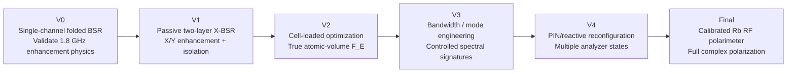

> **Archive status: Historical fabrication-oriented concept and geometry specifications; not proof of fabrication.**
>
> Source: user's historical research Library file: **Manufacturable X-BSR design study** (2026-09-28). Imported as original text extracted from the saved research document; embedded sandbox links or old source markers may be inactive. Distinguish *proposed* from verified results. Underlying source JSON/attachments can be separately recovered for exact byte-level archival.

---

# Manufacturable X-BSR Metasurface for a 1.8 GHz Rydberg RF Polarimeter

## Executive summary

The design I recommend taking forward is a **70 × 50 mm, two-copper-layer, no-ground-plane, electrically excited crossed split-loop resonator with co-located bow-tie capacitive gaps**, fabricated on **Rogers RO4003C**. I will retain the working name **X-BSR**, but there is an important electromagnetic refinement: for a PCB mounted face-on to an incoming RF wave, it should not be treated as a textbook magnetically excited SRR. Instead, the geometry is deliberately folded so that the incident electric field drives a central bow-tie capacitance while the surrounding C-shaped trace supplies the inductive path. That makes it much better suited to normal-incidence illumination from a horn or antenna in front of the vapor cell.

The seed geometry is now fully parameterized rather than conceptual. The L1 resonator has a horizontal central gap and is intended to respond predominantly to \(E_x\); the L2 geometry is the exact same resonator rotated \(90^\circ\), producing the \(E_y\) channel. The two 0.60 mm capacitive gaps project onto exactly the same \((0,0)\) point. The board is placed with its rear copper **1.0 mm from the outside face of the Rb cell by default**. The actual laser waist, glass-wall thickness/material, and distance from the front wall to the optically interrogated Rb volume remain unknown and therefore must be introduced before the design can legitimately be called “optimized.”

This architecture is well motivated by existing Rydberg work. A subwavelength SRR coupled to a vapor cell at 1.3 GHz produced about **100× field/sensitivity enhancement** and lowered the demonstrated mixer sensitivity to \(5.5~\mu{\rm V\,m^{-1}\,Hz^{-1/2}}\); that work also showed that loop dimensions and the capacitive gap strongly control resonance, and that resonant enhancement is inherently narrowband. Separately, Anderson *et al.* demonstrated a passive resonator integrated with an **Rb** cell that simultaneously provided field enhancement and polarization selectivity, reporting an enhancement corresponding to 24 dB in intensity sensitivity. Those results justify the resonator-assisted Rydberg concept; the geometry below is specifically adapted to your flat 70 × 50 mm “PCB in front of the cell” constraint rather than copied from either experiment.

At 1.8 GHz,

\[
\lambda_0=\frac{c}{f}\approx 166.6~{\rm mm},
\]

so the complete PCB is only approximately

\[
0.42\lambda_0\times0.30\lambda_0.
\]

Consequently, I would **not** begin with an array of many small periodic cells. The first board should behave as a single finite dual-polarized meta-resonator occupying most of the available aperture. A periodic/multicell architecture can be investigated later if the full-wave solution shows an advantage.

The complete seed-design package is available here:

**[Download the complete X-BSR V1 design package ZIP](sandbox:/mnt/data/XBSR_V1_seed_design_package.zip)**

It contains the vector copper artwork, engineering drawing, annotated architecture, exact coordinates and machine-readable parameters. These files are intended as **simulation/CAD masters, not as unvalidated production Gerbers**; the correct route is SVG/coordinates → CST/HFSS + KiCad/Altium → optimization → DRC → native Gerber export.

## Architecture and electromagnetic rationale

The physical stack is:

\[
\text{RF source}
\rightarrow
\text{L1 X-resonator}
\rightarrow
\text{RO4003C}
\rightarrow
\text{L2 Y-resonator}
\rightarrow
1~\text{mm air}
\rightarrow
\text{cell glass}
\rightarrow
\text{Rb interaction volume}.
\]

**[600-dpi architecture PNG](sandbox:/mnt/data/xbsr_design/XBSR_architecture_annotated_600dpi.png)** · **[Vector architecture SVG](sandbox:/mnt/data/xbsr_design/XBSR_architecture_annotated.svg)**

The front red conductor is one continuous **folded open loop**. Starting at one side of the central capacitor, current follows a bow-tie plate, rises through a narrow stem, travels around the large C-shaped outer inductive path, returns down the opposite stem and terminates at the second bow-tie plate. The electrical discontinuity is therefore the **central 0.60 mm gap**, not an inconvenient gap somewhere at the edge of the board.

That choice solves an important issue with simply placing a conventional SRR flat in front of the cell. In the Holloway geometry, the enhanced configuration had incident \(E\) along one resonator axis and \(H\) normal to the SRR plane. For your normal-incidence PCB geometry, propagation is approximately along \(z\), so both incident \(E\) and \(H\) are transverse to \(z\). A flat conventional SRR therefore cannot rely on the same normal magnetic-flux excitation. **The proposed X-BSR instead deliberately exposes a strong electric dipole across its central capacitive gap.** The surrounding folded loop supplies inductance and electrical length, allowing the physical aperture to remain compact.

The first-order equivalent model is therefore

\[
f_0\approx \frac{1}{2\pi\sqrt{L_{\rm eff}C_{\rm gap}}},
\]

where the folded perimeter predominantly changes \(L_{\rm eff}\), while \(g\), tip width, flare, substrate and the nearby glass predominantly alter \(C_{\rm gap}\) and fringe-field loading. This is exactly why the nominal dimensions below are **seed dimensions rather than a claim that the unsimulated board already resonates at precisely 1.800 GHz**. The published 1.3 GHz Rydberg-SRR experiment itself found a modeled resonance of 1.307 GHz and a measured resonance of 1.309 GHz, with measured enhancement below simulation because of real material/fabrication losses. The two channels are:

\[
\text{L1: bow-tie axis }\parallel x
\quad\Rightarrow\quad
E_x\text{-dominant response}
\]

and

\[
\text{L2: bow-tie axis }\parallel y
\quad\Rightarrow\quad
E_y\text{-dominant response}.
\]

Both capacitors are centred at

\[
(x,y)=(0,0).
\]

That co-location is essential. We do not care about producing the largest field somewhere on the PCB; we care about producing a large, calibrated field **at the volume occupied by the Rydberg atoms probed by the lasers**. Holloway *et al.* used probe and coupling beam FWHM values of approximately 800 and 300 μm respectively, illustrating that the experimentally interrogated atomic volume can be far smaller than the RF structure. Your own beam waist is presently unspecified, so optimization must ultimately use your measured optical weighting rather than those literature dimensions.

There is also an important polarimetry limitation to establish now. Two orthogonal enhancement channels are an excellent starting point for \(E_x/E_y\) discrimination, but **two amplitude measurements alone do not uniquely recover arbitrary complex polarization** because they do not, in general, recover the relative phase

\[
\Delta\phi=\phi_y-\phi_x.
\]

Rydberg atoms themselves are capable of vector polarimetry: Sedlacek *et al.* demonstrated arbitrary microwave polarization determination with 0.5° resolution. More recently, complete three-dimensional Rydberg RF polarimetry explicitly extracted amplitudes **and relative phases** using three independent orthogonal heterodyne local oscillators. Therefore V1 should be regarded as the passive dual-linear enhancement/calibration platform; full handedness and complete complex-polarization reconstruction become the later reconfigurable or phase-sensitive version.

## Dimensioned design package and parametric geometry

The dimensioned drawing below is the geometry I would place into CST/HFSS first.

**[600-dpi engineering drawing PNG](sandbox:/mnt/data/xbsr_design/XBSR_engineering_drawing_600dpi.png)** · **[Vector engineering drawing SVG](sandbox:/mnt/data/xbsr_design/XBSR_engineering_drawing.svg)**

The fabrication-coordinate system is defined in the PCB plane with the **origin at the geometric board centre**, \(+x\) along the 70 mm dimension and \(+y\) along the 50 mm dimension. In a PCB package that prefers positive coordinates, simply use

\[
X_{\rm CAD}=x+35~{\rm mm},
\qquad
Y_{\rm CAD}=y+25~{\rm mm}.
\]

The raw copper files are:

**[L1 front/X copper vector SVG](sandbox:/mnt/data/xbsr_design/XBSR_L1_front_X_copper.svg)**  
**[L2 back/Y copper vector SVG](sandbox:/mnt/data/xbsr_design/XBSR_L2_back_Y_copper.svg)**  
**[Exact geometry-coordinate CSV](sandbox:/mnt/data/xbsr_design/XBSR_geometry_coordinates.csv)**  
**[Machine-readable parameter JSON](sandbox:/mnt/data/xbsr_design/XBSR_seed_parameters.json)**

The nominal and optimization parameters are:

| Parameter | Symbol | V1 nominal | Recommended optimization range | Role |
|---|---:|---:|---:|---|
| PCB width | \(B_x\) | 70.00 mm | fixed | Matches cell aperture |
| PCB height | \(B_y\) | 50.00 mm | fixed | Matches cell aperture |
| X-template envelope | \(L_x\) | 40.00 mm | 34–44 mm | Main resonance / inductance |
| X-template envelope | \(L_y\) | 36.00 mm | 30–40 mm | Inductance and coupling |
| Main trace width | \(w\) | **1.20 mm** | 0.60–2.00 mm | \(L\), loss, Q |
| Central gap | \(g\) | **0.60 mm** | 0.30–2.00 mm | Capacitance / hotspot |
| Bow-tie tip width | \(w_t\) | **1.00 mm** | 0.50–2.00 mm | Gap-field extent |
| Bow-tie base width | \(w_b\) | **6.00 mm** | 4–10 mm | Capacitance / mode shape |
| Bow-tie taper length | \(L_t\) | **7.00 mm** | 4–12 mm | Field concentration |
| Included flare angle | \(\theta\) | **39.3°** | derived | Follows \(w_b,w_t,L_t\) |
| Outer corner radius | \(r_c\) | **1.00 mm** | 0.5–2.5 mm | Current crowding / fabrication |
| Top opening half-width | \(a\) | 8.00 mm | 6–12 mm | Folded-arm inductance/coupling |
| L1/L2 lateral offset | \(\Delta x,\Delta y\) | **0, 0 mm** | ±2 mm research sweep | Interlayer coupling |
| Relative layer rotation | \(\alpha\) | **90°** | V1 fixed; 85–95° research sweep | X/Y isolation; possible phase response |
| Dielectric thickness | \(h\) | **0.508 mm** | fabrication fixed | Interlayer coupling |
| Copper thickness | \(t_{\rm Cu}\) | **0.035 mm** | fixed | 1 oz copper |
| PCB-to-glass clearance | \(d\) | **1.00 mm** | 0.5–5 mm experimentally | Field decay/loading |

The flare angle is not independently chosen:

\[
\theta=
2\tan^{-1}
\left(
\frac{w_b-w_t}{2L_t}
\right)
=
2\tan^{-1}\left(\frac{5}{14}\right)
\approx39.3^\circ.
\]

### Exact front-layer copper coordinates

The outer C-loop is specified by its centreline; give it trace width \(w=1.20\) mm and a 1.00 mm centreline fillet at the outside corners:

| Vertex | \(x\) mm | \(y\) mm |
|---|---:|---:|
| \(P_0\) | −8.00 | +18.00 |
| \(P_1\) | −20.00 | +18.00 |
| \(P_2\) | −20.00 | −18.00 |
| \(P_3\) | +20.00 | −18.00 |
| \(P_4\) | +20.00 | +18.00 |
| \(P_5\) | +8.00 | +18.00 |

The left and right folded stems are:

\[
(-8,18)\rightarrow(-7.3,3.0)
\]

and

\[
(8,18)\rightarrow(7.3,3.0),
\]

also at 1.20 mm trace width.

The left bow-tie polygon is exactly:

\[
(-7.3,-3.0),\
(-7.3,+3.0),\
(-0.3,+0.5),\
(-0.3,-0.5)
\]

and the right polygon:

\[
(+7.3,-3.0),\
(+7.3,+3.0),\
(+0.3,+0.5),\
(+0.3,-0.5).
\]

That produces the nominal

\[
g=0.30-(-0.30)=0.60~{\rm mm}.
\]

L2 is generated from **every L1 point** using the exact rotation

\[
\boxed{
\begin{bmatrix}
x_{L2}\\y_{L2}
\end{bmatrix}
=
\begin{bmatrix}
0&-1\\
1&0
\end{bmatrix}
\begin{bmatrix}
x_{L1}\\y_{L1}
\end{bmatrix}
}
\]

so

\[
(x,y)\rightarrow(-y,x).
\]

No additional mirror is applied in the physical coordinate system. When the resulting artwork is assigned to `B.Cu` in KiCad or the equivalent bottom-copper layer in Altium, the PCB CAD package handles the manufacturing-side mirroring. **Do not manually mirror the L2 vector a second time.**

The board outline is

\[
(-35,-25)\rightarrow
(+35,-25)\rightarrow
(+35,+25)\rightarrow
(-35,+25).
\]

Four non-copper alignment crosses are centred at

\[
(\pm30,\pm20)\ {\rm mm}.
\]

I would place these only on a sparse silkscreen/reference layer, with 0.15–0.20 mm lines and approximately 4 mm cross length. They are intentionally outside the active resonator. The raw copper SVGs do **not** put these marks in copper.

One useful consequence of this geometry is that the back resonator, after its \(90^\circ\) rotation, occupies 36 × 40 mm, leaving about 5 mm clearance from its nearest 50 mm board edges. No resonant copper reaches the perimeter.

## Stack-up and PCBWay fabrication specification

RO4003C is a sensible substrate here because Rogers specifies a process dielectric constant of \(3.38\pm0.05\), a design dielectric constant of 3.55, and a typical dissipation factor of 0.0027 at 10 GHz; Rogers also describes RO4003C as compatible with conventional epoxy/glass processing. PCBWay's current quick-order interface explicitly offers **Rogers 4003C**, and its Rogers thickness choices include **0.508 mm**. The release stack should be:

| Order from RF source to cell | Layer | Specification |
|---|---|---|
| Air | incident RF | Plane wave / horn side |
| L1 | Cu, X resonator | 35 µm, 1 oz |
| Core | **Rogers RO4003C** | **0.508 mm nominal** |
| L2 | Cu, Y resonator | 35 µm, 1 oz |
| Air spacer | cell clearance | **1.00 mm nominal** |
| Cell | front glass wall | thickness/material presently unknown |
| Cell interior | Rb + optical beams | interrogation position/waist presently unknown |

PCBWay publishes 35 μm as its 1 oz outer-layer copper thickness, a standard minimum trace and spacing of 0.10 mm, CNC-routed outline tolerance of ±0.20 mm, and a board-thickness tolerance of ±0.10 mm for boards below 1 mm thickness. The nominal X-BSR's 1.20 mm traces and 0.60 mm minimum gap are therefore very conservative relative to the published minimum feature capability. The lower proposed optimization limit of \(g=0.30\) mm is still three times PCBWay's published minimum spacing. I would send PCBWay the following fabrication specification:

| PCBWay setting | Selection |
|---|---|
| Board type | 2-layer rigid PCB |
| Dimensions | **70.00 × 50.00 mm** |
| Material | **Rogers RO4003C only** |
| Dielectric/core | **0.508 mm nominal** |
| Copper | **1 oz / 35 μm L1 and L2** |
| Ground plane | **None** |
| Soldermask | **None, both sides** |
| Surface finish | **Immersion silver preferred** |
| Silkscreen | Minimal alignment/reference marks only, away from resonator |
| Via process | None |
| PTH/NPTH | None required for V1 |
| Impedance control | **No** |
| Edge plating | No |
| Castellations | No |
| Controlled depth milling | No |
| Board routing | CNC routed |
| Electrical test | Standard fab test acceptable |
| Manufacturer marking | Outside active region, preferably removed |
| Panelization | **Single pieces for first prototypes** |

PCBWay's ordering system supports “None” for soldermask and lists immersion silver, OSP, ENIG and other surface finishes. I prefer **immersion silver** for this passive V1 because it avoids deliberately inserting a nickel-bearing ENIG stack directly on a resonant conductor; PCBWay's own ENIG configuration identifies an Au/Ni construction. This is an engineering recommendation rather than a claim from PCBWay that one finish has higher RF Q. OSP would be a useful alternate coupon/fabrication comparison.

There is one subtle fabrication issue worth putting explicitly into the purchase notes: **“0.508 mm RO4003C” must mean the dielectric/core thickness used in the electromagnetic model.** PCB ordering systems sometimes describe a nominal finished-board thickness rather than the dielectric alone. I would therefore put the following in the special instructions:

> Use genuine Rogers RO4003C. Target dielectric/core thickness 0.508 mm with 35 µm finished copper on each external face. No material substitution or change in dielectric thickness without approval. Please provide the proposed stack-up for approval before fabrication.

That prevents a 0.508 mm “finished PCB” interpretation from silently altering the electromagnetic spacing between L1 and L2.

For simulation, I would begin with Rogers' **design \(D_k=3.55\)** and \(\tan\delta=0.0027\), then run dielectric sensitivity around the published process value \(3.38\pm0.05\) as well. Both process and design values are published by Rogers. This is preferable to fitting a single arbitrary \(\epsilon_r\) until the model happens to resonate at 1.8 GHz.

PCBWay does **not** publish a copper-etch dimensional tolerance or front-to-back layer-registration tolerance in the capability table we found. I therefore would not quote one as guaranteed. For robust optimization, use \(\pm0.05\) mm copper-feature variation and \(\pm0.10\) mm interlayer registration as **engineering stress tests**, then ask PCBWay through DFM review whether those values can be guaranteed on this order. The published tolerances we can confidently cite are the board-outline, board-thickness and minimum-feature figures above. ## Cell placement and simulation/optimization protocol

Define \(+z\) from the RF source, through the PCB, into the cell. Put the substrate midplane at \(z=0\). L1 faces the RF source; L2 faces the cell. The **physical distance from the outside of L2 copper to the outer surface of the glass is initially 1.00 mm**.

The crucial quantity we do not yet know is

\[
z_A =
\text{distance from the front glass surface to the atomic interrogation volume}.
\]

Likewise, the probe/coupling beam waists and the detailed geometry/material of the front glass wall are unknown. These must not be hidden by assuming that the atoms lie at the PCB surface.

The first simulation should consequently include two stages.

First, simulate the naked PCB with open/PML boundaries and normal-incidence plane waves, sweeping at least **1.0–3.0 GHz**. Excite \(x\)-linear, \(y\)-linear, \(+45^\circ\), \(-45^\circ\), RHCP and LHCP states. Identify the eigen/current modes, centre frequencies, Q factors and local complex field vectors. The literature shows that a high-enhancement SRR can be strongly polarization selective but also fairly narrowband, so large enhancement and very large fractional bandwidth should be treated as competing objectives rather than assumed to coexist. Second, introduce the actual cell geometry and repeat the optimization. Glass loading is not optional: the published 1.3 GHz Rydberg-SRR calculations explicitly included nearby dielectric structures, and measured/fabricated results shifted and broadened relative to the ideal model. Until your optical geometry is measured, I would implement a **provisional** atomic monitor volume only to make the optimizer functional—for example a 1 mm diameter × 5 mm long cylinder—then run the same design against several volumes and cell depths. That proxy is not an assumed physical beam size; it disappears once your actual laser overlap is measured.

Let \(W(\mathbf r)\) be the normalized optical interrogation weighting. For Gaussian probe/coupling beams it should eventually be constructed from the measured beam intensities rather than treated as uniform. Define useful enhancement as

\[
\boxed{
F_E(f,p)=
\frac{
\sqrt{
\dfrac{\int_{V_A}
W(\mathbf r)
|\mathbf E(\mathbf r,f,p)|^2
\,dV}
{\int_{V_A} W(\mathbf r)\,dV}
}
}
{|E_{\rm inc}(f,p)|}
}
\]

for incident polarization \(p\).

That is the figure that should go into the paper—not the maximum single-mesh-cell hotspot

\[
\max |\mathbf E|.
\]

For component-resolved polarimetry define

\[
G_{ij}(f)=
\frac{
\sqrt{
\left\langle|E_i|^2\right\rangle_W
}
}{
|E^{\rm inc}_j|
},
\qquad i,j\in\{x,y\}.
\]

The two linear polarization extinction ratios become

\[
PER_x =
20\log_{10}
\left(
\frac{G_{xx}}{G_{yx}}
\right)
\]

and

\[
PER_y =
20\log_{10}
\left(
\frac{G_{yy}}{G_{xy}}
\right).
\]

For phase-sensitive calibration, do not discard the complex field. Define

\[
H_{ij}(f)=
\frac{
\displaystyle
\int W(\mathbf r)E_i(\mathbf r,f)\,dV
}{
\displaystyle
E_j^{\rm inc}
\int W(\mathbf r)\,dV
}.
\]

The board is then characterized by

\[
\mathbf H(f)=
\begin{bmatrix}
H_{xx}&H_{xy}\\
H_{yx}&H_{yy}
\end{bmatrix}.
\]

This transfer matrix is much more valuable than simply saying “the X resonator responds to X polarization.” It gives the complex amplitude and phase conversion produced by the physical PCB and can ultimately be calibrated experimentally.

For spatial uniformity use a coefficient of variation,

\[
CV_E =
\frac{\sigma_W(|E|)}
{\mu_W(|E|)},
\]

where lower is better.

Define usable bandwidth by physics rather than by a \(-10\) dB antenna convention that is not relevant to an un-fed field-enhancement sensor:

\[
BW_{\rm usable}
=
\left\{
f:
F_E\ge F_{\min},
\quad
PER\ge PER_{\min},
\quad
CV_E\le CV_{\max}
\right\}.
\]

Then

\[
FBW=
\frac{f_H-f_L}{f_c}.
\]

I would begin the optimization with the following **design goals**, explicitly as targets rather than predicted performance:

| Metric | First-pass target | Stretch target |
|---|---:|---:|
| Co-located resonances | \(1.80\pm0.05\) GHz | \(1.80\pm0.02\) GHz |
| \(F_{E,x}\), \(F_{E,y}\) | ≥ 5 | ≥ 10–20 |
| X/Y enhancement imbalance | < 1.5 dB | < 0.5 dB |
| PER | ≥ 15 dB | ≥ 20 dB |
| \(CV_E\) over true \(V_A\) | ≤ 20% | ≤ 10–15% |
| Initial usable FBW | ≥ 10% | ≥ 20% |
| Resonance split \( |f_x-f_y|/f_0 \) | < 3% | < 1% |

The Holloway SRR achieved enhancement well above these values, but its resonator wrapped around a small cell and put the atoms directly in its gap; your geometry places a flat PCB **in front** of a substantially larger cell. Therefore copying its factor of 100 as a target guarantee would not be defensible. The correct question is how much of the near-field enhancement survives through the 1 mm stand-off, glass wall and unknown internal distance to your atoms.

A suitable multiobjective optimization is

\[
\begin{aligned}
J={}&
-w_F
\log\sqrt{F_{E,x}F_{E,y}}
+
w_P
\left(
10^{-PER_x/20}
+
10^{-PER_y/20}
\right)
\\
&+
w_U(CV_x+CV_y)
+
w_R
\frac{|f_x-f_0|+|f_y-f_0|}{f_0}
\\
&+
w_B P_{\rm bandwidth}
+
w_TP_{\rm tolerance}.
\end{aligned}
\]

Do **not** optimize all variables simultaneously initially. A much more stable sequence is:

1. \(L_x,L_y,a\) to bring the modes near 1.8 GHz.
2. \(g,w_t,w_b,L_t\) to increase useful field enhancement.
3. \(w,r_c\) to control loss/Q and mode shape.
4. \(\Delta x,\Delta y\) and small channel-specific length offsets to recover X/Y degeneracy after cell loading.
5. Only then investigate controlled mode splitting or chirality for complex-polarization discrimination.
6. Finally run manufacturing/placement Monte Carlo.

That ordering matters because the 0.508 mm layer spacing means the two resonators will be electromagnetically coupled. A simulation that tunes an isolated L1 and an isolated L2 separately and then simply overlays them is insufficient.

## Polarimetry observability and development roadmap

The scientific goal should not merely be “make a big hotspot at 1.8 GHz.” The more compelling target is a **known mapping from incident Jones/Stokes state to an enhanced atomic response**.

For a transverse input,

\[
\mathbf E_{\rm inc}
=
\begin{bmatrix}
A_xe^{j\phi_x}\\
A_ye^{j\phi_y}
\end{bmatrix},
\]

the desired device ultimately needs enough independent observables to determine

\[
A_x,\quad A_y,\quad\Delta\phi.
\]

Sedlacek *et al.* established that Rb Rydberg spectroscopy can provide microwave vector information, while Elgee *et al.* demonstrated complete three-dimensional RF polarization recovery using amplitude and relative-phase measurements. That literature tells us something important about our PCB: **a different amplitude for X versus Y is not by itself full complex polarimetry**.

Consequently, V1 should intentionally answer four narrower questions:

Can the planar structure produce large field enhancement **inside** the cell? Can \(x\) and \(y\) polarization generate reproducibly different Rydberg spectra? Can both orthogonal modes be brought to essentially the same centre frequency? Can the electromagnetic transfer matrix be predicted by full-wave simulation and recovered by calibration?

Once those are experimentally answered, V2/V3 can deliberately manipulate interlayer coupling so that \(+45^\circ/-45^\circ\) and RHCP/LHCP produce additional independent responses. A bilayer asymmetric structure may naturally acquire phase-sensitive/circularly selective behavior, but **we should not assume that the present 90° crossed design has adequate handedness discrimination until the calculated RHCP and LHCP transfer functions prove it**.

The robust final solution is likely to be state-selectable. PIN diodes can switch reactive branches so the same PCB sequentially realizes several polarization analyzer states, for example

\[
\mathbf a_1=
\begin{bmatrix}1\\0\end{bmatrix},
\qquad
\mathbf a_2=
\begin{bmatrix}0\\1\end{bmatrix},
\]

\[
\mathbf a_3=
\frac{1}{\sqrt2}
\begin{bmatrix}1\\1\end{bmatrix},
\qquad
\mathbf a_4=
\frac{1}{\sqrt2}
\begin{bmatrix}1\\-j\end{bmatrix}.
\]

Those correspond ideally to X, Y, \(+45^\circ\) and one circular analyzer state and provide a natural route toward Stokes reconstruction. That is a **later topology**, not something I would contaminate V1 with before establishing the passive electromagnetic physics.

A useful additional optimization metric at that stage is the condition number of the calibrated analyzer matrix:

\[
\boxed{\min \kappa(\mathbf A)}
\]

because a metasurface whose analyzer states are mathematically almost redundant can have large field enhancement but terrible polarization-estimation sensitivity.

The development route I would use is:

The key experimental controls for a paper are therefore almost built into the roadmap:

\[
\text{bare cell}
\rightarrow
\text{single X resonator}
\rightarrow
\text{passive crossed X-BSR}
\rightarrow
\text{optimized X-BSR}
\rightarrow
\text{reconfigurable polarimeter}.
\]

That creates a much stronger scientific story than fabricating only the final complicated PCB and trying to infer where its improvement came from.

## Gerber release and fabrication checklist

The supplied SVGs have exact physical units and coordinates and are suitable for importing into PCB CAD or a full-wave solver. For manufacturing, however, **export native Gerbers from the PCB CAD tool after the EM optimization is frozen**. PCBWay accepts Gerber archives and performs another layer/file review before production. I would release the following fabrication files:

| Manufacturing file | Content |
|---|---|
| `.GTL` | L1 front X-BSR copper |
| `.GBL` | L2 rear Y-BSR copper |
| `.GKO` / `Edge.Cuts` | 70 × 50 mm routed outline |
| `.GTO` | Optional four alignment crosses only |
| `.GBO` | Normally blank |
| `.GTS` | Omit because no top soldermask |
| `.GBS` | Omit because no bottom soldermask |
| Excellon drill | None for V1 |
| Fabrication drawing | Stack, critical dimensions, no-substitution note |
| Readme | Material, thickness, finish and orientation |

PCBWay's uploader accepts archived Gerber data and its order page supports single pieces, customer panels or supplier panels with optional break-away rails. For the first experimental boards I would use **single pieces**, probably 5–10 boards, because rails, mouse-bites or V-score remnants near the aperture add unnecessary uncontrolled electromagnetic geometry. If later production is panelized, rails should remain outside the 70 × 50 mm finished outline and every test specimen should be fully depanelized before characterization.

No controlled impedance should be ordered: there is no 50 Ω transmission line or RF connector in passive V1. PCBWay lists impedance control and custom stack-up as separate advanced options, so they need not be selected unless a later PIN-diode version introduces feed/bias structures that require them. The special fabrication note I would attach is:

> **X-BSR RF resonator test coupon. Material must be Rogers RO4003C. No laminate substitution. 0.508 mm target dielectric/core between L1 and L2, 35 μm finished Cu on both faces, no soldermask, no copper pours, no ground plane, no vias within the active structure. Immersion-silver finish. CNC-routed 70.00 × 50.00 mm outline. Central 0.60 mm gaps and front-to-back pattern registration are RF-critical; notify customer before any artwork modification. Manufacturer identification, lot code and tooling marks must remain outside the 60 × 40 mm central active region.**

PCBWay's current form permits removal or specified placement of its product number, so this can be formally requested rather than left to chance. Before production, I would ask PCBWay to confirm three items that its public capability table does not fully specify: **actual L1/L2 registration tolerance, copper dimensional/etch tolerance around the 0.60 mm central gap, and whether the quoted 0.508 mm is dielectric-core or finished-board thickness for this specific RO4003C construction**. That is not bureaucracy: the Rydberg-SRR literature itself observed measurable differences between modeled and fabricated resonators and explicitly attributed some of the discrepancy to fabrication dimensions and losses. The largest uncertainty is actually not PCB fabrication. It is the cell. The next design-defining measurements should be the **front glass-wall thickness/material, distance from the front outer wall to the probe/coupling intersection, probe and coupling beam waists, and the actual optical path through the 70 × 50 mm cell**. Until those quantities are known, optimization of the PCB alone risks maximizing \(E\) at a beautiful 0.60 mm gap while delivering little enhancement at the atoms several millimetres behind it.

The design package to use as the **Geometry-001 / V1 simulation seed** is:

**[Complete X-BSR V1 package](sandbox:/mnt/data/XBSR_V1_seed_design_package.zip)**  
**[Engineering drawing — PNG](sandbox:/mnt/data/xbsr_design/XBSR_engineering_drawing_600dpi.png)**  
**[Engineering drawing — SVG](sandbox:/mnt/data/xbsr_design/XBSR_engineering_drawing.svg)**  
**[Architecture — PNG](sandbox:/mnt/data/xbsr_design/XBSR_architecture_annotated_600dpi.png)**  
**[Architecture — SVG](sandbox:/mnt/data/xbsr_design/XBSR_architecture_annotated.svg)**  
**[L1 X copper — SVG](sandbox:/mnt/data/xbsr_design/XBSR_L1_front_X_copper.svg)**  
**[L2 Y copper — SVG](sandbox:/mnt/data/xbsr_design/XBSR_L2_back_Y_copper.svg)**  
**[Geometry coordinates — CSV](sandbox:/mnt/data/xbsr_design/XBSR_geometry_coordinates.csv)**  
**[Parameters — JSON](sandbox:/mnt/data/xbsr_design/XBSR_seed_parameters.json)**
